# Oído: Spanish listening trainer

Listen to real Spanish audio with a transcript you can hide, loop, shadow and mine for Anki cards.

**Leyendas**, the listening RPG in `rpg.html`: every attack is a line you hear and type. It's set in original Colombian folklore and has loot, sets, bosses and a village.

**Rumbo**, the listening trading game in `rumbo.html`: prices, rumors and contracts arrive only as audio, and you trade on what you understood (see [Rumbo](#rumbo-listening-space-trading-game)).

| | |
|---|---|
| 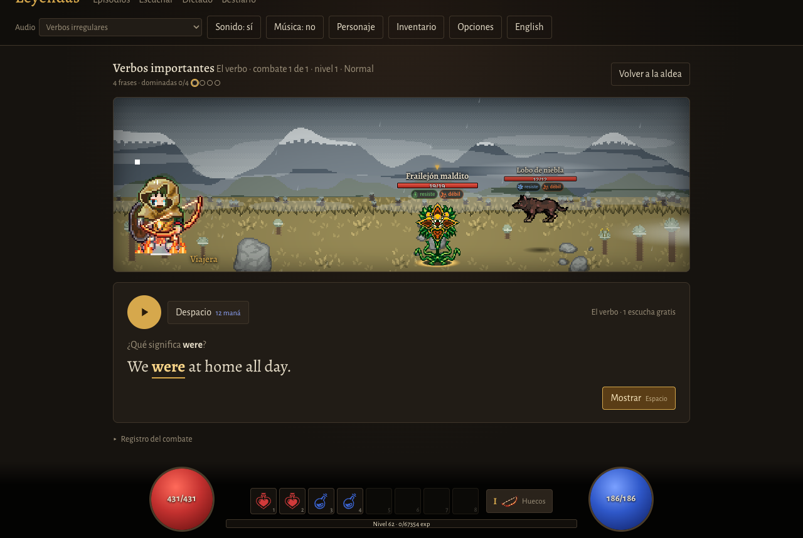 | 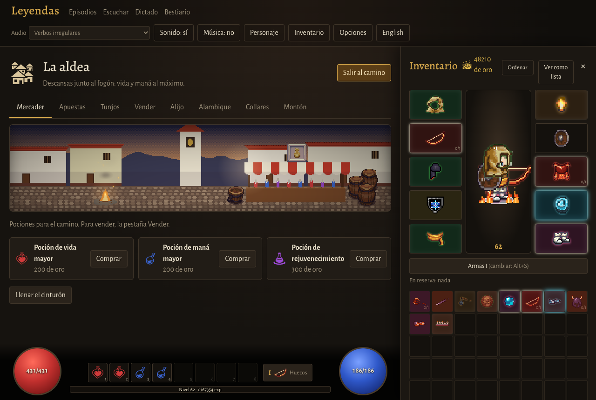 |
| *A fight: each attack is a line to hear and write* | *The village and inventory, with gear on the paper doll* |
| 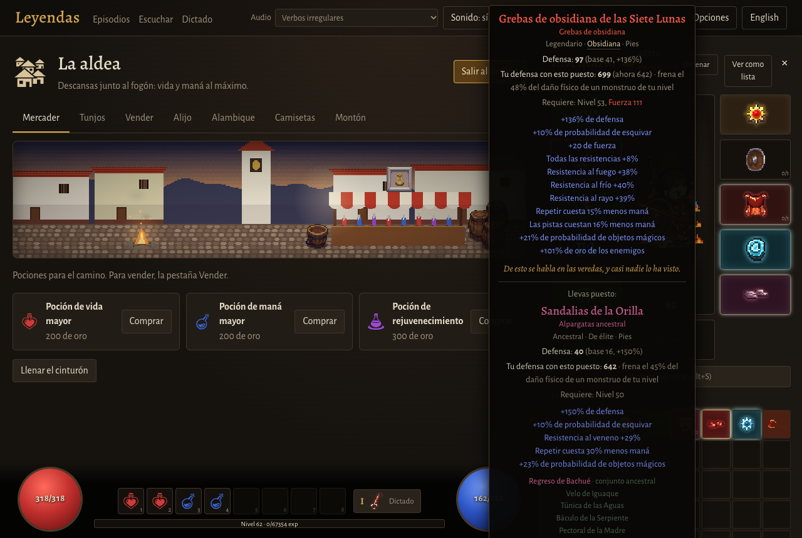 | 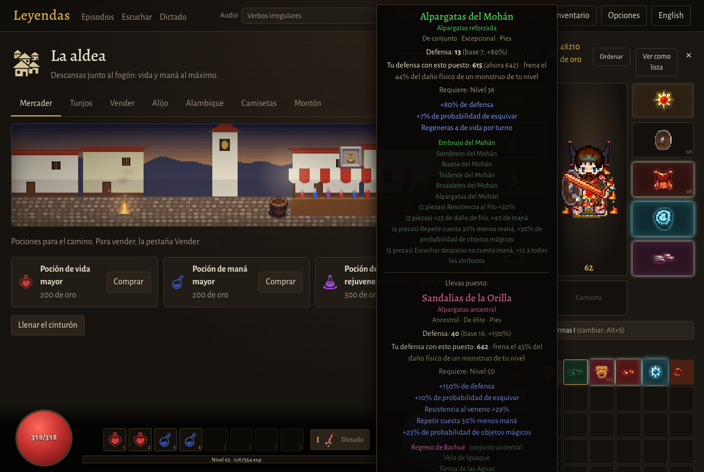 |
| *Item tooltips compare with what you're wearing* | *Set pieces and their bonuses* |
| 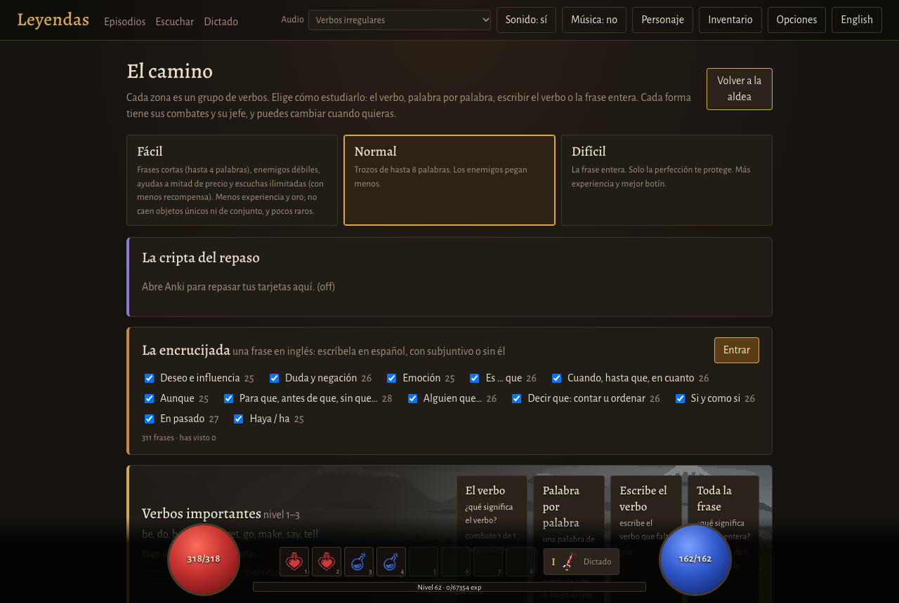 | 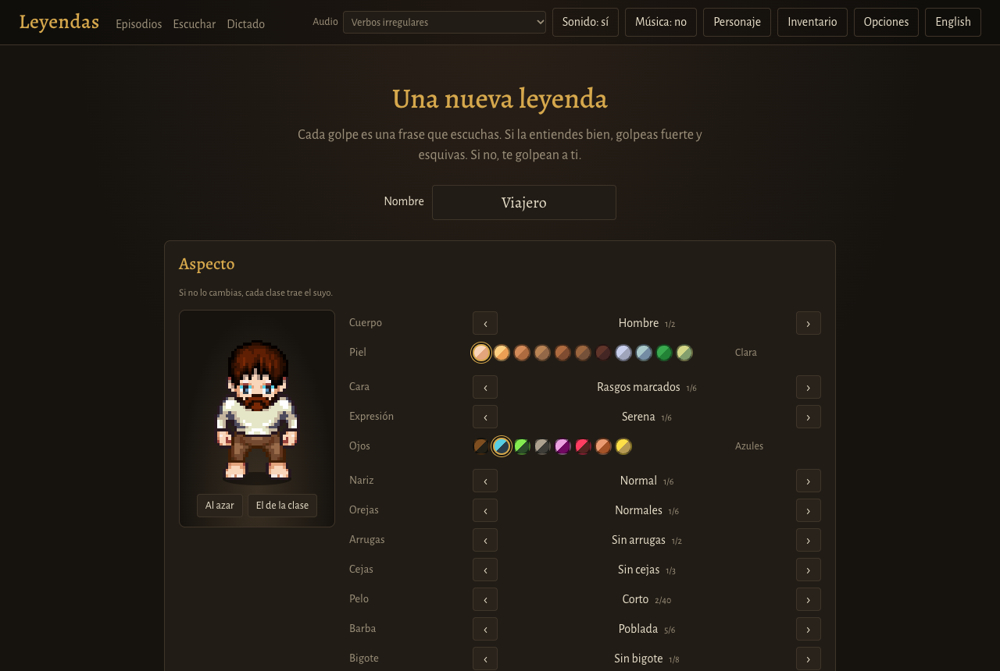 |
| *The map: each zone is a stretch of the episode* | *Make a character: class and look* |
| 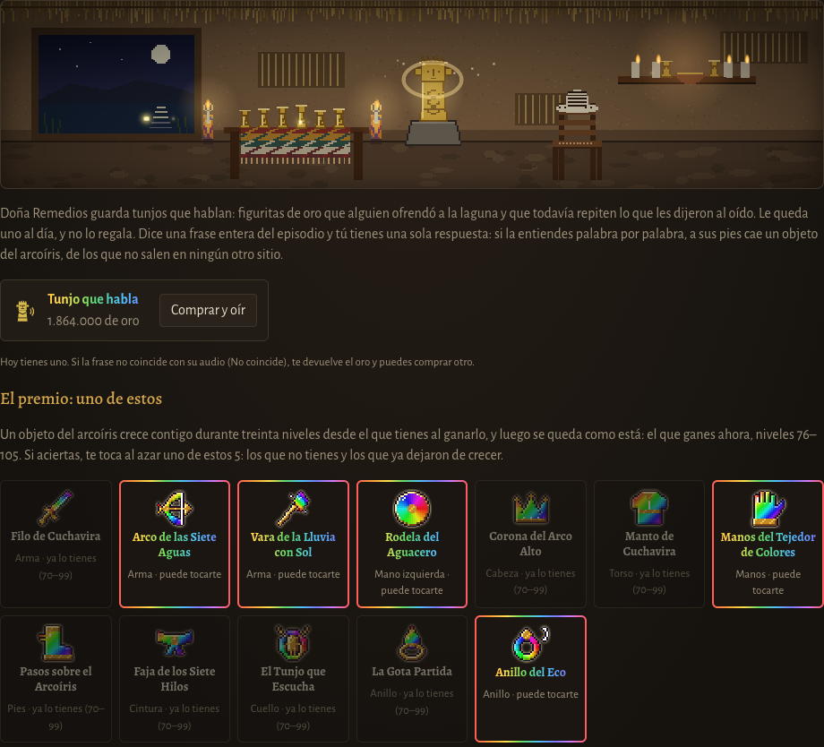 | 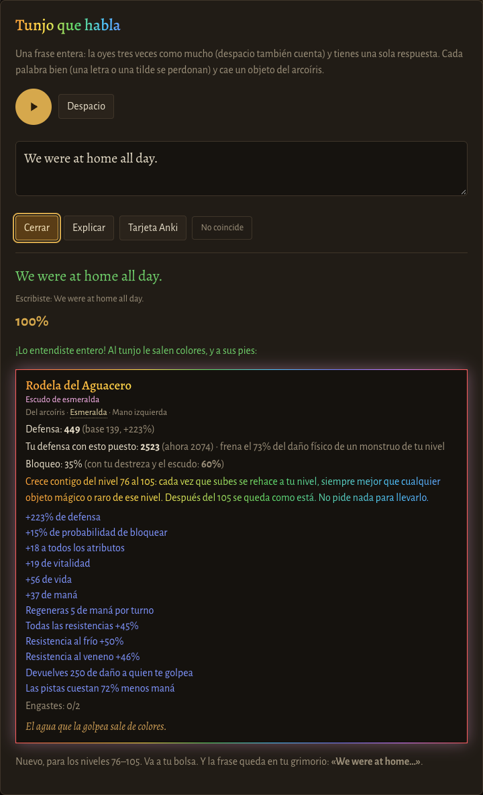 |
| *Doña Remedios' tunjo: one a day, and the rainbow items it can give* | *One sentence, one answer: right, and a rainbow item falls* |
| 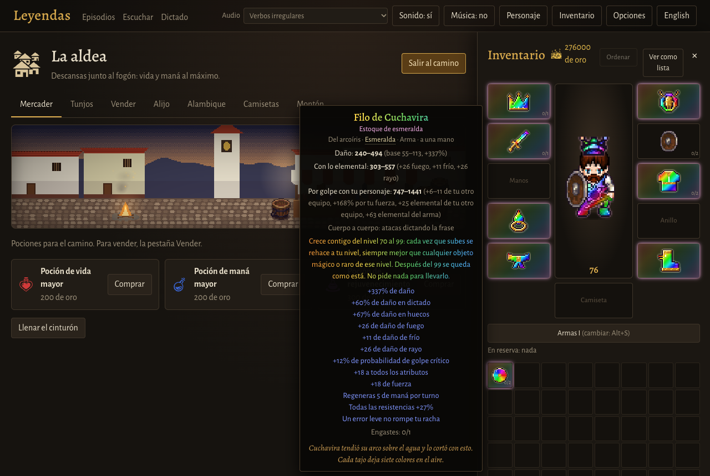 | 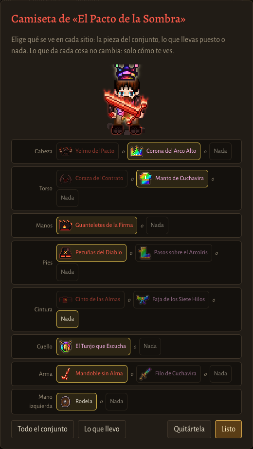 |
| *Rainbow items grow with you for thirty levels* | *A set's undershirt: choose what shows, slot by slot* |

<details><summary>Item designs, sets and undershirts</summary>

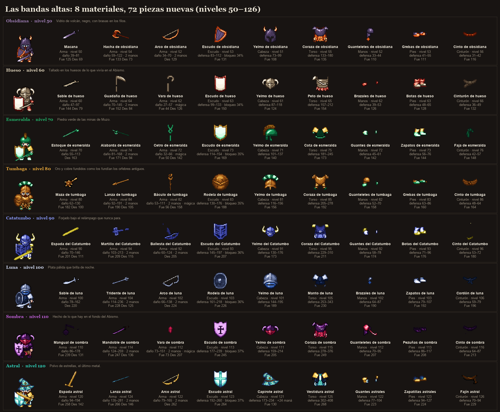

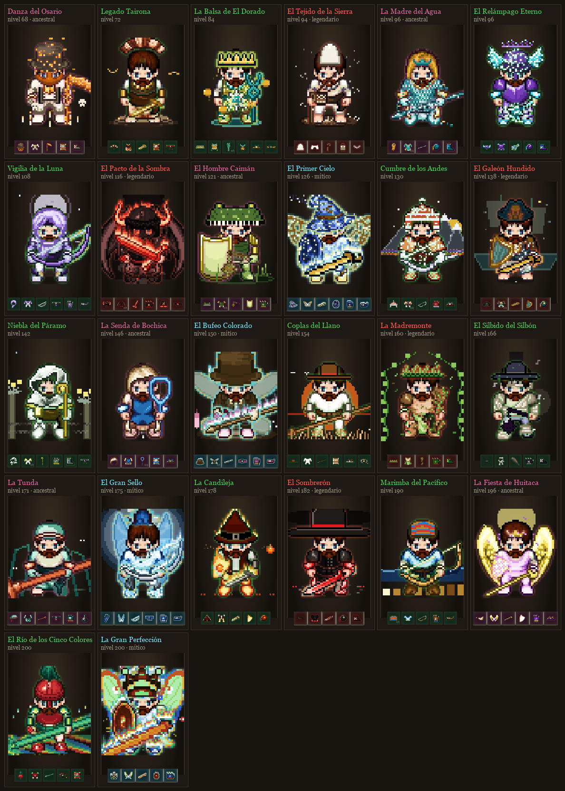

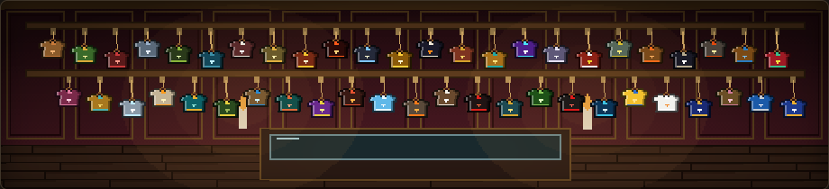

</details>

The art is LPC (Liberated Pixel Cup) and game-icons.net, credited in `public/rpg/**/CREDITS*.txt`. The game ships with one sample course (English irregular verbs, for Spanish speakers). Add your own Spanish audio as episodes: see `CLAUDE.md`.

## Run

```sh
npm install
npm start     # http://127.0.0.1:8790/
```

"Explain" uses the Claude Code CLI (`claude -p`), so it runs on whatever account Claude Code is logged in with, such as your Pro/Max plan. Each answer takes about 5–8 seconds. If `ANTHROPIC_API_KEY` is set, it calls the API directly instead.

## Play (dictation game)

`play.html`, linked as "Play" in the header. You hear a line, then type what you heard ("Dictation") or fill in a few missing words ("Fill the gaps"), and it's scored word by word.
- Accents and punctuation don't count against you, and a one-letter typo gets half points.
- Sounds rather than words (ah, ay, eh, oh, mm, uf, uy, jaja …) don't count in a dictation: leave them out or type them, either way. They're shown greyed in the answer. A line that is only a sound ("Ah.") still counts. Fill the gaps never blanks one. This applies in the RPG too, including Anki cards.
- Every gap is 10 letters wide, and only a longer word makes it wider, so the gap's size doesn't hint at the word (both here and in the RPG).
- Replays, slow replays and hints lower the points for that line.
- Perfect answers on the first listen build a combo multiplier.
- Points add up to levels, with a daily goal of 20 lines and a day streak.
- The strip across the top maps the whole episode, coloured by how you did.
- After checking a line you can replay it, add it to missed lines, ask Claude to explain it or make an Anki card. A card always includes the explanation and looks it up if needed.

Lines with uncertain words or numbers are left out. Progress is stored in the browser (localStorage).

## Leyendas (listening RPG)

`rpg.html` is an action RPG where every attack is a listening exercise on the next line of the chosen episode. The UI is in Spanish. An **English** interface can be chosen with the button at the right of the header or in *Opciones* (`public/rpg/i18n.js`; kept per browser in `oido:uiLang`, and the page reloads). The code stays in Spanish: with English on, the page is translated as it's drawn. Every text node and tooltip is looked up in `public/rpg/i18n/en.json`, where `{0}`, `{1}`… stand for values filled in at runtime (translated too when they have an entry); `en.manual.json` holds hand-written entries for text the code assembles from pieces, and wins. Item names are translated part by part, with adjectives moved before the noun. What you're learning is never translated: the episode's lines, what you typed, the corrections' words, Anki cards, Claude's explanations, the tense names of missed verb forms and La encrucijada's sentences. After adding or changing game text, run `node scripts/i18n/extract.mjs && node scripts/i18n/translate.mjs` (it finds the new strings and has the `claude` CLI translate only those); `leyendasI18nMisses()` in the console lists text left in Spanish on screens you've visited. All the content is original, drawn from Colombian legends, in `public/rpg/data.js`.

- **Combat**
  - Fights are packs of 1–4 monsters, champions (blue), unique monsters (gold) or a zone boss, and take one or many lines.
  - Your accuracy sets your damage. A perfect line on the first listen is a guaranteed critical hit and dodges every attack. Missed words let the monsters hit you.
  - A streak of perfect lines multiplies your damage. It carries on from one group (fight) to the next, and through trips to the village and back out, until you miss a line or fall; *comboStart* gear makes each fight start at least at its value. A miss doesn't lose a streak of 10 or more at once (`REGAIN_FROM`; shorter ones are simply lost): it waits (`ch.streakLost`), and the next 3 perfect lines in a row bring it back plus those 3 (20, a miss, 3 right: 23). The streak counter shows the running count as a glowing, pulsing orange badge (*Recupera tu racha de 20* with three dots that light up one per perfect line, the newest popping in and the next one blinking, and *2/3*); the hit banner and the log show each step too, and each of the three has its own sound (a low bell, a higher bell, then a rising run with a shimmer as the streak comes back, `sfx.regain`), and getting it back flashes *¡Racha recuperada!* in gold; another miss on the way back loses it for good, and falling clears it. Past 10 in a row the damage bonus is capped.
  - **The ear streak** (*Racha de oído*, `F.ear`, saved as `ch.earStreak`) runs alongside the streak: perfect lines in a row heard only once (no replay, no slow play, no hint). Hearing a line twice, or any miss, ends it (it can't be won back, and it gives no damage bonus). Only listening lines count: Anki recall and subjunctive cards leave it alone. It rolls its own streak dice with the same odds and prizes (`E.streakRoll` on its count), in blue, so a perfect first-listen line can roll both sets at once; the two boxes sit side by side over the stage, and the counter shows *Oído 9* with its own chance next to the streak's. Flagging a line gives it back, and falling clears it.
  - **Event log** (`lineLog` in `main.js`, `handleLines` in `server.js`): everything that happens with a line is recorded for looking back and for features to come (spaced review of lines and words, streaks of days, stats). Events wait in `localStorage` (`leyendasLineLog`) and go to the server 15 s after the last one and when the page is hidden; the server appends them, one JSON object per line, to `data/lines.jsonl` (online: `data/lines/<user>.jsonl`), ready to load into a database. `GET api/lines` downloads it; *Descargar registro de frases* in the character sheet does the same. Every event has `t` (epoch ms), `ev` and `sid` (the page load). The kinds:
  - `session`: the device (`dev` phone/desktop, `vw`/`vh`), time zone and offset, language, user, class, level, difficulty, lines so far, muted.
  - `fight` (`fid`): episode, zone, boss, review source, level, the monsters (tier, modifiers), difficulty, character level. `fightEnd`: `how` (won / died / left / done), duration, answers, right answers, streak, life %, gold, xp, level.
  - `show` (`id`, `fid`): the line shown: episode, `si`, `part`, its words and text, `start`/`end` in the audio, mode, zone, boss, review, the Anki card (id, deck, text), difficulty, level, and how you stood (streak, ear streak, life %, mana, lines today).
  - `answer` (same `id`): time to answer (`ms`) and to the first key (`firstKey`), keys pressed, each listen (`[ms from shown, normal|slow]`), plays, slows, paid listens, hint, Anki ease, accuracy (`acc`, `strict`), `right` (100%), `perfect` (100% on the first listen), what you typed, and every word as `[word, typed, 2 right | 1 near | "a" accent | 0 missed | "n" a name that doesn't count]`.
    Since the listening rating (below), `show` also has `ex` (the exercise key) and `fresh`, and `answer` has `ex`, `fresh`, and for a fresh line `rk` (`dict` or `cloze`), `feat` (its raw features), `rs` (its score S), `pred` (the predicted score E) and `th0`/`th1` (θ before and after). An identify or tunjo trial logs an `answer` too (`src: "trial"`, with the trial's title).
  - `flag` (the line was flagged as not matching the audio), `dice` (which dice, streak, roll, needed, win, prize), `goal` (today's goal reached: goal, last day's lines, gold), `level` (a new level).
- **Índice de oído: a listening rating** (phases 1–3 of `data/spec-indice-de-oido.md`, `public/rpg/rating.js`; 2026-11-27). A rating like a chess rating, measured only on lines heard for the first time, so it shows how well you understand new audio, untouched by gear, potions or difficulty. Two ratings: dictation (`dict`) and filling the gaps (`cloze`).
  - **The model.** Before a fresh line, its features are standardized against the corpus (cut at ±3 SD) into `x`, and the predicted score is `E = sigmoid(θ − w·x)` (no intercept: θ = 0, shown as 1500, is 50/50 on an average line of your episodes). After the answer, with its score S: `θ += Kθ (S − E)`, `Kθ = max(0.08, 0.5 / √(1 + n/20))`, and `w −= η (S − E) x + λ (w − w0)` (η 0.01, λ 0.001): doing worse than predicted makes lines like this one count as harder. Starting weights `w0`: rate 0.8, len 0.3, rarity 0.3, maxRarity 0.2, accents 0.1, quiet 0.4. All in `RATING` in `rating.js`, untuned until there are fresh lines from a new episode (Seinfeld S09E03).
  - **Stored** as `ch.rating[kind] = { th, n, hist: [[day, th], …] }` (one point a day, the day's last) and `ch.ratingModel[kind] = { w }`. Shown as `round(1500 + 200 θ)`, *provisional* under 50 rated lines.
  - **In the game:** after a fresh line, next to the verdict, *Frase nueva · esperado 62% · +14* (green up, red down; its tooltip gives the rating and the score). Lines heard before show nothing. Flagging the line as not matching its audio undoes its change (`rateUndo`). The identify and tunjo trials show the same. **Personaje → Índice de oído**: each rating with *provisional* while it is, a small line over the days with 1500 dashed (hover a day for its value), and how many lines it has counted. **Opciones → Índice de oído** (`ch.rateTag`, off by default): a tag on a fresh line before you answer, *Fácil / Media / Difícil / Brutal* from E (0.75 / 0.5 / 0.25), gone once you answer; it never shows a word.
  - **Eval** (`node scripts/rating/eval.mjs [data/rating-replay.json] [--exact]`, after the backfill): for each rating, the game's own predictions and a replay of the model from scratch over every fresh answer (each predicted before it updates), with the log loss against always predicting the mean, a calibration table by tenths (mean predicted against mean actual), and the learned weights. `--exact` leaves out answers from before the game decided freshness. The backfill's rating isn't imported into the game: those older answers' freshness is only approximate, and the game seeds what's been heard from the character itself.
  - **Fresh lines.** Every stretch of audio a line plays is remembered (`ch.heard`: per episode, per line, `1` for all of it or the `[a, b)` word ranges played). A line or part of a line is fresh only if none of its words' audio was played before in any mode, so a part of a line already heard whole, or the second pass of a gap line, isn't. Lines answered in Dictado (`game:<ep>` in the listening pages' storage) or played in Escuchar (before the furthest point it reached, kept as `ch.listenFar`) aren't fresh either. Not rated: Anki cards, La encrucijada, the review crypt, El Remolino, flagged lines, courses, English episodes, and lines that are only sounds or names. Identify and tunjo trials are rated when their clip is a whole fresh line.
  - **Seeding** (`seedRating`): the first time a character opens the map, everything it has already answered counts as heard (its mastery records, struggles, weak words' lines), and its word history starts from them; `ch.ratingSeed` marks it done, and no line is rated until then.
  - **Word history** (`ch.words`: `{ seen, hit, miss }` per normalized word across all episodes, from every scored word except names and sounds; `trackWords` and the trials). Seeded from mastery records (a perfect record is a hit for each word) and weak words (their hits and misses).
  - **Corpus word frequency** (`GET api/wordfreq`, `wordfreq()` in `server.js`): every word of every Spanish transcript in `MEDIA_DIR` (not English ones, not courses), counted, cached in `data/wordfreq.json` and rebuilt when a transcript is added or changed. Rarity = `-log((count + 1) / total)`. It also holds the mean and SD of each line feature over every playable line, computed once: `dict` over whole lines, `cloze` over the gaps the game would pick (`chooseBlanks`).
  - **Features of a line** (`lineFeatures`): `rate` (syllables per second, by a Spanish vowel-group count, ×1.15 under the Parlanchín), `len` (log of 1 + words, without sounds and names), `rarity` and `maxRarity`, `accents` (share of words with an accent or ñ), `quiet` (the Murmullo). Also, from your own history, `unseen` (share of words never scored) and `missRate` (smoothed). Only the line's own features will count toward the rating: your history with its words improves as you learn, and counting it would hide that progress. It's kept for "what makes lines hard for you". For gaps, the features are of the gapped words, and the speed is the whole line's.
  - **Score of an answer** (`answerScore`): strict accuracy (accents count; gear that forgives them doesn't) × 1 / 0.75 / 0.6 for 1 / 2 / 3+ listens × 0.8 for any slow listen × 0.6 for a hint. Answers with help still count. The constants are in `RATING` in `rating.js`.
  - **Replay** (`node scripts/rating/backfill.mjs [data/lines.jsonl] [--out data/rating-replay.json]`): goes through the log's answers in order, rebuilds heard audio and word history, works out each fresh answer's features and score, writes them out and prints a summary. Answers from before 2026-11-27's change have no `fresh`; for those, fresh means first in the log, which overcounts, so they're marked `approx`. Tests: `node --test scripts/rating/`.
  - **The Índice de oído screen** (phase 3; `renderOido`, view `oido`; *Ver* in the map's *Índice de oído* panel, under the crypt). Each rating as a card (*provisional · 40 de 50*, the change since the last day). A line chart of both ratings, one point per fresh line (dictation `#ab8430`, gaps `#6f86f0`, checked for colour blindness on the dark panel; 1500 dashed; labels at the line ends; hover a point for its line, date, expected and actual score; *Ver como tabla* for the numbers). It's drawn at the phone's own width there, so its text stays readable. *Últimas frases nuevas*: the last 15 with expected, actual and the change (*desafío* marks the challenge's). *Qué te cuesta*. *¿Acierta la predicción?*: from 20 fresh lines, by quarter of the predicted score, the mean predicted and mean actual. *Episodios*. The Desafío's rules and record. The fresh lines behind it are kept in `ch.ratingLog` (the last 300: time, kind, episode, line, its text, E, S, θ; flagging a line takes its entry out).
  - **Qué te cuesta** (`costsHtml`): the learned weights in plain sentences, one per feature and case, so each translates whole (`COSTS`): the biggest (*La velocidad es lo que más te cuesta*), any under 0.1 (*… casi no te afecta*), and any that moved 0.1 or more from where it started (*… te cuesta más / menos de lo que se suponía al principio*). Bars show each weight now, with a mark where it started. Under about a thousand fresh lines it says it mostly repeats the starting guesses.
  - **Episode difficulty** (`episodeDifficulty`, `labelEpisodes`): for each Spanish episode, its fresh lines (playable, no word of them heard, not done on the listening pages) and the predicted dictation score on them, at your rating now. The episode picker shows it (*Seinfeld — Temporada 9, Episodio 3 · 57% (365 nuevas)*), and so does the screen, with the fresh lines left in total. Transcripts are fetched once (`TS_CACHE`).
  - **Desafío de oído** (`challengeIntro`, `startChallenge`, `nextChallengeLine`, `endChallenge`; on the map panel and the screen): five minutes of fresh lines from the current episode, whole and out of order, one after another in the identify trial's dialog, with the time, hits, misses (○○○) and the rating in its header. 90% or more, accents counting (`strictAcc`), is a hit; three misses, or the time, end it (a line under way can be finished). It picks the fresh line whose prediction is nearest the target, among the 4 nearest: 70% at first, down to 50% after 12 hits. Every line is rated as dictation, counts toward mastery (dictation, whole line), weak words, lines today and lines answered, and a hit pays gold `(10 + 3 × level) × (1.5 − E)` and a little experience; no items. Closing the dialog ends it. The record (most hits, best rating gain, runs) is in `ch.challenge`; the log gets `challenge` events (start, end with hits, misses, lines, gain, gold, xp). It uses up fresh lines, so the screen says how many are left. Only the current episode for now; drawing from every episode is for later.
  - Not built: the spec's online per-line difficulty (the game is local only), and zones choosing fresh lines near your rating.
- **Today's goal** (`todayGoal` / `countToday` in `main.js`): a light nudge to play a bit more each day. Each answered line counts for the local day (`ch.days`, the last two weeks). Today's goal is the lines you answered on the last day you played in the past week plus a tenth (at least 3 more), or 20 the first time; it's fixed for the day when it's first worked out (`ch.dayGoal`). A thin bar shows it under the group's line in a fight and above the zones on the map (*Hoy: 12 de 34 frases (ayer, 31)*). Reaching it gives, once a day, a bag of gold (40 + 12 per level, times the difficulty's gold), a log line and a toast; the bar turns green (*Meta cumplida ✓*). Undoing a line takes it off the count too.
- **Lighter on the computer** (2026-11-27). The frame loop that stops a line at its end and moves the play button's ring (`watch` in `main.js`; the same in `play.js`) runs only while audio plays: it used to run 60 times a second forever, even idle in the village. Glows that pulsed a shadow or a filter every frame (the target's ring, mythic items' glow, the loot button) now fade a ready-made glow in and out, which the GPU does on its own. **Opciones → Animaciones de fondo** (on by default; `localStorage` `rpgCalm`, per device) turns off the scenes' and village's particles (fog, rain, embers…) and makes every looping animation play once and stop (`body.calm`); hits, dice and celebrations still play.
- **You can see when the line is playing** (`markPlaying` / `markDone` in `main.js`). While it plays, the button you pressed lights up: on the play button, little bars bounce where the triangle was and a ring fills round it as the line goes; on *Despacio*, bars after its label and the button filling left to right. When it stops, the button flashes green with a tick, and a small ✓ stays on it until the next line. The same for Anki cards with audio, and in the identification trial (its own play and *Despacio* buttons, `#tPlay` / `#tSlow`).
- **Foreign names don't count when they're wrong.** A word that's part of a non-Spanish proper name (Kramer, Puddy, Thomassoulo, Play Now) can't be expected to be spelled from hearing it, so typing it wrong, or leaving it out, counts as right (in dictation, gaps and voice answers, here and on the listening pages). It shows dotted and grey in the answer, with what you typed on hover, and it never becomes a weak word. Spanish words and names (María, Holanda, Dios) still count. The list is per episode, `names` in its `transcript.json`, made by `node scripts/find_names.mjs media/<id> [--force]` (Claude picks them from the episode's capitalised words; the import scripts run it at the end). Only the word as written in the line, capitalised, is exempt.
- **Streak dice** (`streakRoll` in `engine.js`, `streakDice` / `showDice` in `main.js`; they replace the old +1% rare-loot luck per line past 10): from a streak of 5, every perfect line rolls percentile dice, and you win a prize if the roll is at or under the streak's chance: 1% at 5, one point more every 2 lines, at most 15% (10: 3%, 20: 8%, 30: 13%). A win rolls a gold d20 plus 1 per 10 of the streak (at most +4) for the prize: 1–10 a bag of gold (`(200 + 60 × level) × (1 + streak/10)` ×0.8–1.2, with gold find: about five bosses' gold; ten times what it was until 2026-11-27), 11–15 a gem (a grade better than usual), 16–19 a rare, set or unique item, 20–21 ancestral, 22–23 legendary, 24 mythic (only a natural 20 on a streak of 40+). Fácil gives a unique instead of the top three tiers. Simulated over a streak from 5 to 30: about 1.8 wins, 0.77 gold, 0.45 gem, 0.37 rare-or-better, an ancestral about 1 such streak in 5–6, a legendary about 1 in 14. The prize is yours from the roll, but it shows up (gold in your purse, a thing in your bag, then the stash, then the ground; set and top-tier items unidentified; and its log line) only when the dice reveal it, so the inventory doesn't give it away first; closing the show early with Enter, 20 seconds passing, or leaving the page gives it at once (`r.grant` in `streakDice`). The log records every roll: a win with the prize, a miss quietly (*sale 52; ganabas con 1 a 8 (8% de probabilidad). Sin premio*). Every roll starts small: a layer over the whole page (`.diceshow`, which lets clicks and typing through, so the fight goes on underneath) shows, at half size near the top and with nothing dimmed (`.quiet`), a box ringed by chasing marquee bulbs with two bone-white dice that tumble in 3D, clatter and land on the roll, and what you needed under them. A miss stays that small: *Sacas N*, a soft bonk (`sfx.diceLose`), and it's gone in under half a second. Only a win opens into the casino show: the box flies to the middle of the screen at full size, everything behind it dims behind turning light rays. Then it rings the casino alarm bell, runs a fanfare up two octaves to a held brassy chord with a cymbal and coins pouring (`sfx.diceWin`). The screen flashes white and jolts, and the dice glow gold. The box grows about a third bigger (a little on a phone), and gold coins rain over the whole screen. It flashes *¡Premio!*, speeds up the rays and bulbs, and the rays cycle through the rainbow. It and rolls the gold d20 with its bonus. The prize lands with a burst of gold coins and sparks in its colour and the sound of coins pouring into a slot machine's tray followed by a run of bells (`sfx.jackpot`), plus a second rain of coins and sparks in the prize's colour and a beam over you for an item. The top tiers turn it into *¡Jackpot!*, with rays in the prize's colour, the screen flashing, two bursts, a longer peal and a jolt. While a win is on screen, Enter or Escape closes it (the prize is already yours) and doesn't reach the line underneath; the next Enter goes on as usual. Both streaks rolling on the same line put their boxes side by side (one above the other on a phone), the ear's in deep blue. The streak counter and the hit banner show the next line's chance (*dados N%*). Anki reviews and *Subjuntivo o no* roll them too (the ear streak's only where you listen). The fight log keeps the last 12 lines (scrolling past what fits), so boss lines aren't pushed out by the rolls; the Mandingas's offer is logged word for word. Rolls and wins are counted in `ch.stats.diceRolls` / `diceWins`.
  - **One big scene at a time.** A boss's finisher or a critical hit plays first, at the moment of the blow. The dice wait for it to end (`pendingDice`), and the victory celebration waits for both, so a winning roll on the line that kills a boss plays finisher, dice, victory in that order. If the victory is waiting, the dice keep their prize up for 1.5 s instead of 3–4 (`hurry`). While a scene is up, messages such as *¡Nivel N!* move to the very top of the screen (smaller on a phone) and stay above it, so a level-up on the same line is still seen.
  - **Victory celebration** (`celebrateWin` in `main.js`, `sfx.groupWin`): every group beaten gets the same show as the dice, over the whole screen and letting clicks and keys through, so the loot buttons under it work at once. A white flash, rays turning, the marquee box with *¡Grupo derrotado!* and the zone's name. The gold counts up, and each drop pops in one after another with its icon and name in its rarity's colour (unidentified ones by rarity; at most 8, then *y N más*). Rare and better ones glow, and their colour tints the rays and a second rain of sparks. Coins rain down over a trumpet call and a cymbal. A boss gets *¡Victoria!*, bigger, with its name, the road that opens, twice as many coins, and a longer fanfare with a drum roll up to an octave-high chord. It fades after about 3 seconds (5 for a boss, a little more per drop) and goes as soon as you move on.
  - Accents count: a word that's right except for its accent (or ñ) costs 1% of the line and is underlined, so no line is 100% without every accent. This applies in the dictation game too.
  - Extra words typed before the first or after the last word of the line don't count against you (the clip often catches a fragment of the next or previous line). They show in grey italics.
  - A line that has at least one accent or ñ, typed with every word and every accent right (*Tildes perfectas*), raises the chance that the kills from that attack drop rare, set or unique items (about 1.4×). Lines with no accents don't get the bonus.
  - **Filling gaps with words you already know cuts the rare loot.** Every word you fill in right in a gap is counted per character, across episodes (`ch.gapKnown`, `gapFreshness` in `main.js`). Each earlier right answer makes it a fifth more "known", fully from the 5th. The kills from that attack have their odds of rare and better (rare, set, unique and the three tiers above) multiplied by 1 − 0.85 × how known the gaps were on average (a missed word counts as fresh). So a word right for the 2nd time gives ×0.83, then ×0.66, ×0.49, ×0.32, and from the 6th time ×0.15 when every gap was one. The result line shows it (*Huecos ya sabidos: botín raro ×0,49*, with the words on hover). Dictation, Anki cards and course lessons aren't affected, and neither are zone prizes, gold or potions.
- **Weapons decide the exercise:** melee weapons attack by dictation, and bows, slings, wands and staffs attack by filling the gaps. Filling the gaps needs something typed in every gap before the line counts (a guess is fine): with one left empty, Enter on the last gap or the attack button jumps to the empty one, shakes it red and says *Rellena todos los huecos*. You carry two weapon sets and swap with Alt+S.
- **Mana pays for listening help:** the first listen is free, while replays, slow listens and hints cost mana (a replay costs 2 + 0.45 × level; a slow listen 1.5 replays; a hint 8 replays, more than a warrior's whole bar without mana gear, so hints need gear, potions or a brujo). Potions sit on the belt (keys 1–9; Alt+1 life, Alt+2 mana); a click on a potion in the bag puts it on the belt (right-click for the other options). On the paper doll your figure is alive: every few seconds it moves slowly into another stance (facing you, side-on either way, the weapon raised ready from its own attack's frames), and it keeps its place while the bag changes; still with reduced motion. *Ordenar* at the top of the bag sorts it like the stash: gear (best rarity first; within a rarity, each set's pieces together in the set's own order, then the rest by slot, higher level first; an unidentified set piece goes with the rest, since it doesn't say its set yet), gems, potions. The item list's Objeto column sorts the same way.
- **Monster modifiers can change the audio:**
  - *Murmullo*: the line plays quieter
  - *Parlanchín*: the line plays 15% faster
  - *Eco*: no slow listens
  - *Maldito*: hints cost double
- **Elements:** monsters marked Fuego, Frío, Rayo or Veneno deal half their damage as that element; your matching resistance reduces it. Monsters also resist, are immune to, or are weak to the elemental part of *your* damage (fire, cold, lightning, poison from gear and gems), shown under their name: fire creatures ignore fire and fear cold, ghosts and the undead ignore cold and poison, plants and mummies burn. Physical damage is never resisted. Ígneo / Gélido / Eléctrico monsters resist their element at least 75%. The table is `MONSTER_RES` in `data.js`.
- **Loot**
  - Rarities: worn (grey), normal (sometimes *superior*, 10–25% better), magic (blue, 1–2 affixes), rare (yellow, 3–6 affixes), crafted (orange, from the alembic), set (green, 5 sets with bonuses), unique (gold), and *palabra rúnica* only on items kept from before runes were removed (below).
  - **Set pieces whose undershirt you already have** (on the Camisetas shelf or on you, `hasShirt`) carry, once identified, a small green-framed shirt in the top-left corner of their slot in the bag and the stash, and their tooltip says *✓ Ya tienes su camiseta* (and *la llevas puesta* when you wear it).
  - **A set piece's tooltip shows which pieces you have:** the pieces you wear are bright and marked *✓ puesta*; the rest stay dim, with *✓ en la bolsa* or *✓ en el alijo* beside any you're carrying or have stored (identified ones only).
  - Uniques: 127 written by hand (levels 3 to 134): 58 for the early game, and 69 more for levels 64 to 134 (added 2026-11-27), on the high bands' bases (one or more per material and slot, Hueso to Astral) and jewellery. The high ones' damage and defence grow with their level, and most of their other properties are percentages (`lifePct`, `allStatsPct`, a share of your damage as an element…), like the runas'. Measured on the same base at their level, weapons come out about 1.1–1.45× a median legendary (below a mythic) and armour about 1.1–1.2×, where the early ones sit too. A hand-written unique only comes from a drop (or the alembic) at most 15 levels above its own level (`UNIQUE_SPAN` in `engine.js`), so a level-100 drop is never a level-9 unique; before 2026-11-27 any lower one could come, and past level 50 about half were 20+ levels below the drop. A third of unique drops (and all of them when no hand-written one is that close, past about level 149) are invented: a random base named after someone (*Machete del Herrero Tuerto*) or a stand-alone title (*La Trasnochada*), 4–6 strong affixes, a listening property, a flavour line.
  - Bows for the long road: a recurve bow base (*Arco recurvo*, level 26, LPC recurve art; reinforced 44, elite 62), and six bow uniques on reinforced and elite bases so they keep up in the Abismo, each with its own wood colour in the hand: *Arco del Pescador de Luna* (27), *Arco de la Madremonte* (29), *Arco de Bochica* (44), *Arco de las Siete Lunas* (46), *El Vigía del Páramo* (49), *La Flecha que Vuelve* (62). Sets with bows: *Rastro del Jaguar* (regular set, level 42, 5 pieces on reinforced bases: recurve bow, leather, hood, gloves, boots; tawny and gold), the Laguna's *Arco de la Ofrenda* (Ancestral) and the Origen's *Arco del Eco Eterno* (Mítico).
  - The Camisetas tab's picture is a tailor's room with two rails of pegs, one per set (59), staggered so they don't overlap; each undershirt you own hangs on its peg on a wooden hanger (drawn apart in `v-camisetas-shirts.png`, placed by `v-camisetas-shirts.json`, both from `build_scenes.py`), the one you're wearing shown faint.
  - **Opciones** (header button, or *Qué recoger…* on the loot screen): what the main *Recoger* button picks up after a fight, per character (`ch.pickup`). A box for every kind of loot: equipment by rarity (unidentified items count by the rarity their colour shows), each potion, each gem grade; anything that somehow has no box is always picked up (`pickKey`/`wanted` in `main.js`). Extra rules pick up equipment of any rarity: at least a chosen number of sockets (one choice, 1–6 or none; 2 means 2 or more; older saves with several ticked use the smallest), or *better than the best you have* in the places ticked: what you wear, your bag, your stash (wearable now and raises one strength number, hit × toughness × a little for the listening helps, with the item swapped in, the way equipping swaps it; with several places ticked it must beat all of them; what you wear includes both weapon sets (I and II), and a weapon is only compared with weapons of its own kind, melee with melee and ranged with ranged, wherever they are; nothing of that slot there, such as an empty slot even behind a two-handed weapon or no shield in the stash, means anything wearable counts; unidentified items don't count). Unwanted drops stay on the ground, faded, with a dashed border and a *no se recoge* tag (fading alone looked the same as grey *gastado* items), and can still be clicked.
  - **The second three top-tier sets**, two per tier, for the Abismo: *Regreso de Bachué* (ancestral, 50: the Muisca mother who came out of Lake Iguaque; a teal veil and robes, a serpent staff; a golden serpent winding round the figure over lake water), *Silencio del Nevado* (ancestral, 64, ice: a steel sugarloaf helm, frosted mail, an ice-blue blade; snow, frost, a ring of ice shards), *Señor de los Vientos* (legendario, 58, wind: a feathered bandana, sky-blue coat, a sabre; wind streaks and leaves, a whirlwind round the legs), *Corazón de la Montaña* (legendario, 72, earth: a closed bronze helm, heavy plate, a great hammer, a kite shield; the ground cracking with fire, boulders turning round), *La Rueda del Tiempo* (mítico, 68, Kalachakra: a gold crown, deep-blue robes, the wheel as a sceptre; a turning wheel in the five colours, seven planets), *La Luz Clara* (mítico, 80, Dzogchen's rainbow body: a yogi's topknot, white robes, a clear crystal, a mirror on the heart; a sphere of rainbow light). Unlike the Laguna, Cóndor and Origen (redrawn in the tier's gradient), these keep their own colours and art (`SET_LOOKS`), with the tier's glow; they drop as the first three do (`makeTopItem`, about a third of top-tier drops, from 4 levels below the set's level).
  - **The second eight sets** (levels 34–60, `SETS` in `data.js`), each with art of its own rather than its bases' recoloured: every piece is its own combination of generator layers (`SET_LOOKS` in `build_lpc.py`; weapons keep their base's kind of move, so the attack animation still matches; the robe and kimono exist only for the female body, so a shirt that fits the male body goes under them), plus an animated ornament drawn in code (`custom_art.py`), small with part of the set and fuller with all of it. *Hálito de la Ciénaga* (34, poison: a swamp witch's sackcloth hood, mossy robe and a scythe; a bubbling pool, marsh lights), *Embrujo del Mohán* (36, cold: the river sorcerer's huge hat, weed-ragged cape and fishing spear; river water at the feet, a leaping fish), *Senda del Yogui de las Nieves* (40, Tibetan: white cotton and a maroon shawl, a 108-bead mala, felt boots; warm breath rising, prayer flags in the five colours), *Rayo Diamantino* (44, Tibetan, lightning and spells: a gold crown, maroon and saffron robes, a crystal vajra; a lotus at the feet, a halo of five lights), *Pacto del Averno* (48, fire: a horned black visor, a red glowing blade, hooves; flames at the feet and a burning ring), *Cólera del Trueno* (52, lightning: a winged helm, mail and navy cape, a halberd; sparks, a storm cloud with rain and a bolt), *Custodia del Sol* (56: a crested gold helm, gold plate and cape, a longsword, a round bronze shield; a sun disk with turning rays), *Ira del Protector* (60, Tibetan wrathful protector: black and maroon, a war axe; an arch of the fire of wisdom with five skulls along it).
  - Above unique, three rarer tiers, each always stronger than the one below: **Ancestral** (rose), **Legendario** (crimson) and **Mítico** (cyan). Their properties come from deeper affix tiers and are boosted (×1.15 / ×1.3 / ×1.5), with a big +% damage or defence, one or two listening properties, all resistances (Legendario, Mítico) and all attributes (Mítico). They're named after the base plus a tier epithet (*Daga del Nombre Verdadero*), fall unidentified (longer lines to identify), and look like nothing else: the whole piece redrawn in the tier's colours, a crest, plume or wings on helmets and pauldrons or a cape on body armour, and a brighter glow (Mítico pulses). Each tier has its own set, whose pieces only drop in that tier, about a third of that tier's drops once you're near the set's level: *Ofrendas de la Laguna* (Ancestral, 5 pieces with a bow, level 18), *Gesta del Cóndor* (Legendario, 5, level 30), *La Voz del Origen* (Mítico, 6, level 38). Tier set pieces use the best version of their base for the drop's level and get some of the tier's extras on top of their fixed properties. All three sets have original art, drawn in code (`scripts/custom_art.py`, pixel grids and procedural frames, no outside files): their own icons (bag, ground, tooltips), and an ornament worn with any piece of the set, fuller with the whole set on: the Laguna's gold dust falling around you over a pool of lake water, plus three little gold tunjos circling your waist with all five pieces; the Cóndor's black wings folded behind the shoulders, spread wide and beating with all five pieces; the Origen's rings of sound spreading at the feet and motes of light orbiting, plus a halo behind the head with all six. The ornaments are animated in fights (a strip per animation, like the LPC layers) and still in the portrait.
  - Zone prizes: getting every phrase of a zone to 100% pays once, with a celebration screen: by filling the gaps (both passes), a Legendario or Mítico item (30% Mítico); by dictation, always a Mítico. Once per episode, zone, descent and way of playing, on any difficulty; the map shows each prize and whether you've had it, and pays zones finished before prizes existed (or when the bag was full) the next time you open it.
  - Base tiers: every weapon and armour base also comes reinforced (*reforzado*, from 18 levels later) and ancestral (*ancestral*, 36 levels later) with much better damage or defence, higher requirements, and one more socket for ancestral.
  - **El Remolino, each episode's last level** (`remolinoZone`, `buildRemolino` in `main.js`): below the Abismo on the map, locked until every line of the episode (the five zones and every descent) is mastered by dictation or by gaps; the card shows how many. Each run is built anew when you enter it: up to 36 lines ranked by how much they've cost you (`ch.struggle`, plus 0.3 × the weak-word score of the words in them; fastest speech fills the rest), groups climbing towards the worst and the worst 12 for the boss, who is the boss of the zone your worst line comes from. A line you get perfect there has its weight halved. Level: past the Abismo's last descent (or your level, if higher). Prize for beating its boss: a mythic the first time, a legendary after.
  - **Starting an episode over**: a button under the map (`restartEpisode`) puts the episode's zones back as if opened for the first time, shifted to your level now. Mastery, prizes already got and weak words stay.
  - **Progress is per episode** (`ch.zonesByEp`, `useEpisodeZones` in `main.js`): which zones are cleared, the group you're on and the Abismo's descents belong to the episode. The first time you open an episode it starts at the first zone, with every zone's monster levels shifted so the first begins at your level then (`ch.epShift`, fixed for that episode: at level 40 the Páramo is 40–44 and the Abismo 74+); the map says so. The progress from before this belongs to whichever episode was open when it arrived, unshifted. Picking another episode in the header redraws where you are (a fight in progress ends and you go to the map; a fallen character stays fallen).
  - **The Abismo's descents cover the rest of the episode.** The five zones and the Abismo's first descent hold 336 lines, and episodes have 350–1,171, so the Abismo's card on the map lists one row per descent until the episode's end (`descentsOf`/`descentList` in `main.js`): its stretch (*Descenso 2 · nivel 37 · 16:07–19:04*), dictation and gap mastery, prizes got, and *Entrar* for any descent you've reached (*Seguir* on the current one; `ch.zones.abismo.maxDepth` keeps the deepest). The last descent ends where the episode ends, overlapping the one before rather than running on into the start; past it, a row for going deeper, where the episode starts over. Each descent's prizes (all lines at 100% by dictation, and by gaps) are awarded separately. Descents are counted from 1.
  - **High bands** (`BANDS` in `data.js`): every ten levels from 50 to 130, a material of its own (Obsidiana 50, Hueso 60, Esmeralda 70, Tumbaga 80, Catatumbo 90, Luna 100, Sombra 110, Astral 120) and a full kit in it, 72 bases in all: a one-handed weapon, a two-handed one, a bow, crossbow or staff, a shield, helmet, body armour, gloves, boots and belt, spread over the band's first levels. Each uses a shape the ordinary bases don't (a barbuta with horns, a pig-faced bascinet with ram's horns, a legion helm with a plume, hooves, a celestial hat …) and is drawn wholly in its band's material, a gradient over its shading, with some parts in the band's accent (`BAND_LOOKS`, `BAND_STOPS`, `BAND_ACCENT` in `scripts/build_lpc.py`): the obsidian's embers, the emerald's gold, the Catatumbo's lightning, the shadow's red. Rarity shows in the name and glow; ancestral, legendary and mythic pieces are redrawn in their tier's colours over the band's shapes. Stats follow the best ordinary bases' curve a little above, with no reinforced or ancestral versions (the next band is the next step). The tooltip names the band (hover for a line about it). From item level 60 (`RETIRE_AT` in `engine.js`) the ordinary designs, with their reinforced and ancestral versions, stop dropping: every new piece of gear is a band design (jewellery excepted, which has no band versions), in drops, the merchant, crafting and invented uniques and top-tier items alike; only the hand-written uniques and the older sets keep their own bases. From 50 to 59 both drop, the ordinary ones half as likely as before and the bands' counted double (band pieces about 13% of gear at 52, a quarter at 58, then about 90% with the rest jewellery). Bases 30+ levels below the item level fade to a fifth.
  - **The high bands' sets**, built on the band pieces, each drawn in colours of its own over the band's shapes (`SET_BAND_STOPS` in `build_lpc.py`) with an animated ornament of its own (`custom_art.py`) and an undershirt on the Camisetas rack: *Danza del Osario* (ancestral, 68, Hueso pieces: marigold petals falling; whole set, a ring of candles and three dancing skulls), *Legado Tairona* (72, Esmeralda: stone terraces at the feet; whole set, two gold birds circling), *La Balsa de El Dorado* (84, Tumbaga and an amulet: gold discs turning; whole set, more of them trailing gold dust over lake water), *El Tejido de la Sierra* (legendary, 94, the Arhuaco of the Sierra Nevada de Santa Marta: Catatumbo and Tumbaga pieces and an amulet, which don't take their band's shapes but their own (`SET_BAND_LOOKS`), in white cotton and natural wool. The tutusoma and the mochila are drawn in `custom_art.py` and placed frame by frame where the helmet and sash would be, so they follow the figure through every animation (`reanchor`). A white tunic over white trousers, a walking stick and a necklace of white beads complete the set. Its ornament is a mochila's base woven in a spiral at the feet, turning slowly; with the whole set, a cotton thread winds up round you and snow drifts past), *La Madre del Agua* (ancestral, 96, Tumbaga and Catatumbo pieces and a ring, in river teal and gold: a ribbon of river water with strands of gold hair spiralling up round you; whole set, a pool at the feet with gold fish leaping), *El Relámpago Eterno* (96, Catatumbo: a crown of lightning; whole set, bolts striking either side), *Vigilia de la Luna* (108, Luna, 6 pieces, a bow and a silver cord: the cord replaced a buckler, which the two-handed bow left unwearable, and older bucklers still count; a crescent behind the head; whole set, a full moon and pale moths), *El Pacto de la Sombra* (legendary, 116, Sombra, 6: black smoke with embers; whole set, a horned shadow with red eyes behind you), *El Hombre Caimán* (ancestral, 121, Sombra pieces and the astral shield, swamp green with yellow eyes: reeds swaying and fireflies; whole set, dark water with a caiman's eyes and ridge rising out of it), *Cumbre de los Andes* (130, Astral pieces in red wool and snow, with a ruana and a bow: snow falling; whole set, snowy peaks behind with the sun coming up and a band of a chumbe's seven colours), *El Primer Cielo* (mythic, 126, Astral, 6: stars wheeling round; whole set, the Milky Way and constellation lines). Their properties and bonuses carry on the older sets' curve. Since the per-piece rework they no longer use the band's shapes either: every piece has its own art in `scripts/set_art.py`, like the sets from 138 up (below). The Osario's catrín wears a top hat, a skull mask and a striped frock coat, with marigold petals off his scythe. Tairona has a plumed gold band and a woven manta. El Dorado's diadem of gold rays is drawn by hand, with gold dust off his legion plate and a glowing sceptre. The Madre del Agua has long golden hair, a tiara and scale mail, and her spear drips. The Relámpago has a winged nasal helm and a mace crackling with sparks. The Vigilia has a pale veil with moon earrings. The Pacto has horns that burn, bat wings and a hellfire longsword. The Caimán has caiman jaws for a hat, drawn by hand, and a scutum. The Andes have a chullo with ear flaps, drawn by hand, a red ruana, and snow falling off it. The mythic Primer Cielo gets a crescent-moon star hat, monarch wings in stars, a comet-flamed sabre, comet-trail slippers and a pale glow on everything. Their gloves, boots, belts, the Dorado's amulet and the Madre del Agua's ring have drawn icons (new shapes: a pendant, a hoof).
  - **The sets from 138 to 200**, fifteen more at the same spacing (a plain set about every 12 levels, an ancestral one about every 25, a legendary one about every 22, a mythic one about every 25), all of 6 pieces on Luna, Sombra and Astral bases, since there's no band above Astral. None pairs a two-handed weapon with a shield, so the whole set can be worn at once (only the weapon set in use counts). Every piece has art of its own (`scripts/set_art.py`): its own combination of generator layers (`RECIPES`, with a fallback layer where one only exists for one body), hats drawn by hand where the generator has nothing right (the llanero's, the Silbón's torn sombrero, the Sombrerón's hat wider than he is, the Madremonte's crown of ferns, the cantadora's head wrap), and effects worked out frame by frame from the piece's own pixels: a glow round the outline, flames off its top edges, drops, leaves, a piece drawn bigger. The mythic sets go furthest: the Bufeo's oversized white top hat spouting water and a spear in pink and aqua flames, the Gran Sello's huge topknot, pale wings and a bow burning white, the Gran Perfección's giant crown and greatsword ablaze in the five colours, lunar wings and a five-coloured halo round every piece. Gloves, boots, belts and the ring are a few pixels on the figure, so their icons are drawn: a shape each (gauntlet, glove, bracer, mitt, claws; tall boot, short boot, sandal, slipper, sabaton, the Tunda's whisk leg; buckle, sash, rope, cord, a bag) with a motif of its own (a doubloon, a leaf, a note, an eye, a bone…), the mythic ones burning. Their properties follow the top sets' per-level curve, by tier: armour about 2.5–2.8 × the level, damage 4 × the level, an element about 1.15 × the level, times 1.08 for ancestral, 1.15 for legendary and 1.3 for mythic. Every one has the same bonus ladder (resistance and life at 2, its listening damage and element at 3, cheaper replays and free slow listens at 4, a free replay and a head start on the streak at 5, near misses count and the streak survives at 6) and an ornament and an undershirt of its own:
    - Plain: *Niebla del Páramo* (142: mist drifting at the knees; whole set, two frailejones with nodding yellow flowers and drops of water), *Coplas del Llano* (154: plains grass swaying; whole set, a huge setting sun on a flat horizon and herons crossing it), *El Silbido del Silbón* (166: whistled notes spiralling up; whole set, his tall thin shadow with the hat and the sack), *La Candileja* (178: three balls of fire circling; whole set, trails of sparks and glowing grass), *Marimba del Pacífico* (190: marimba bars at the feet lighting up in turn; whole set, Pacific waves and a humpback's tail rising), *El Río de los Cinco Colores* (200, Caño Cristales: stripes of red, yellow, green, blue and black water flowing past; whole set, the colours rise higher and spray glitters).
    - Ancestral: *La Senda de Bochica* (146: a thin waterfall behind, foaming at the feet; whole set, a wide fall and Chuchaviva's rainbow over it), *La Tunda* (171: mangrove roots and fog; whole set, the roots climb high and pale eyes blink among them), *La Fiesta de Huitaca* (196: petals whirling in a dancing ring; whole set, a full moon and an owl's wings opening across it).
    - Legendary: *El Galeón Hundido* (138: bubbles rising and gold doubloons sinking; whole set, a ghost galleon behind), *La Madremonte* (160: leaves whirling; whole set, vines framing you and a storm of leaves), *El Sombrerón* (182: a ring of chain links; whole set, an enormous black hat overhead and red dog eyes at the feet).
    - Mythic: *El Bufeo Colorado* (150, the pink river dolphin: river ripples; whole set, the dolphin leaping over you), *El Gran Sello* (175, Mahamudra: a disc of clear sky with clouds forming and dissolving; whole set, a wide open sky), *La Gran Perfección* (200, Dzogchen: a sphere of five-coloured light breathing; whole set, rays and small spheres of light floating round).
  - **The bodhisattvas and Guru Rinpoche** (11 sets, `SETS` in `data.js` after Dzogchen; ornaments in `custom_art.py`). Unlike every other set, their worn pieces take nothing from the LPC library: `scripts/orig_art.py` draws every piece from scratch, in every frame of every pose and animation (front, side, slash, thrust, shoot, spellcast, hurt, ride) and for both bodies. To know where the body is in each frame, it renders a few LPC layers only to measure them (a headband for the head, a sleeveless shirt for the shoulders, a long-sleeved one for the elbows, gloves, shoes, a belt, and the base's own weapon or shield for where it's held and at what angle) and then draws hoods, crowns, robes, skirts, sashes, sandals, bracers, staffs, swords, vajras, the khatvanga, the phurba, the kite shield and the mirror around those points, with a pixel-art outline and shading. Hats and crowns are small pixel pictures in the file. `build_lpc.py` uses it for these sets instead of the layer recipes (`ORIG.has_art`); the glows and flames from `set_art.py` still go over them. The three ways of a bodhisattva's heart, from the teachings on bodhicitta: the shepherd who sees the whole flock across before himself, the boatman who crosses with everyone, the king who gets there first to open the way. And the eight manifestations of Guru Rinpoche (Guru Tsengye). Spread from 88 to 198 so they keep dropping as you climb:
    - Plain: *El Bodisatva Pastor* (88, on Tumbaga: hood, wool cloak, crook; sheep walking ahead at the feet; whole set, a long flock and the stream they cross before him), *Shakya Senge, el León de los Shakya* (118, on Sombra, 5 pieces with an alms bowl amulet: saffron robe and maroon shawl, a staff; a saffron halo; whole set, light round the body and lotus petals at the feet), *Loden Chokse, el que Busca el Saber* (134: white and pale blue, the prince of learning; pages of scripture circling the head; whole set, a ring of them round the body).
    - Ancestral: *El Bodisatva Barquero* (100, on Luna, 5 pieces: river blue, a conical straw hat, a punting pole dripping water; a ferry rocking under the feet; whole set, passengers in it and the far shore ahead), *Tsokye Dorje, el Vajra Nacido del Lago* (128: lake blue and lotus pink, a vajra; a lotus open on the water; whole set, rings spreading over the lake), *Padmasambhava, el Pandita Nacido del Loto* (156: the scholar, maroon robes and the pointed pandita hat with its lappets; the khatvanga; a five-coloured rainbow behind; whole set, wider, with books floating either side).
    - Legendary: *El Bodisatva Rey* (112, on Sombra: purple and gold, a glowing crown, longsword and kite shield; a road of light opening ahead; whole set, a royal parasol and banners), *Pema Gyalpo, el Rey Loto* (144: red robes, gold crown, a shining mirror; lotus petals behind like a throne; whole set, a white parasol and flashes off the mirror), *Nyima Özer, Rayos de Sol* (168: the yogi, nearly bare, a tiger-skin skirt and bone ornaments, a glowing khatvanga; sunrays behind; whole set, the sun burning over his head).
    - Mythic: *Senge Dradrok, el Rugido del León* (186: wrathful dark blue, a crown of five skulls and a vajra in flames; a wreath of flames; whole set, higher flames and the roar going out in rings), *Dorje Drolö, el de la Tigresa* (198: dark red-brown and tiger skin, a burning skull crown and an outsized phurba; a wreath of fire; whole set, the pregnant tigress he rides prowling beneath).
    - Stats from the same curve as the sets from 138 up (each piece's role by base, one or two theme properties, bonuses at 2–6 pieces; a 5-piece set gets the full-set bonus with its fifth).
  - **The sets from 204 to 400** (2026-11-27): 59 more, one every 3–4 levels, in the same tier mix (27 plain, 12 ancestral, 11 legendary, 9 mythic), so there are as many above 200 as below. Colombian places and legends (Teyuna, the Tatacoa, San Agustín, Tierradentro, Chía and Sué, the Salt Cathedral, the Chocó's rain, Yuruparí, Pulowi and Juyá, the Quimbaya treasure, the Zenú filigree, Mompox, the Nevado del Ruiz, Chingaza, the Magdalena, Karagabí and Tutruica, Serankua and Aluna, Cartagena's walls, Chiminigagua, Nencatacoa, the Zaque and the Zipa, the Cauca canyon, the Orinoco's rapids, Calima gold, the barniz de Pasto, San Andrés, Malpelo, the rainforest, the Llorona, the Mula de Tres Patas, the Sayona) and the Buddhist lineages (Green Tara, Milarepa, Mañjushri, Chenrezig, Naropa, Tilopa, Marpa, Yeshe Tsogyal, Machig Labdrön, the Medicine Buddha, Gampopa, the Black Crown, Nagarjuna, Vajrasattva, Shantideva, Vajrayogini, Mahakala, Amitabha, the Prajñaparamita, the bardo, Samantabhadra, the Five Buddhas and, at 400, the Wheel of the Dharma). 5 to 8 pieces each, on Luna, Sombra and Astral bases plus amulets and rings; the mythic ones go up to 8 pieces (bonuses at 6 and 7 add magic find and experience, the full set the last tier). None pairs a two-handed weapon with a shield. Their numbers carry on the high sets' per-level curve (`scripts/new_sets_400.py`, which wrote them into `data.js` once, with their colours into `build_lpc.py` and `build_scenes.py`): a plain weapon +4% damage per level, a head 2.55% defence per level, and so on, ×1.07 ancestral, ×1.18 legendary, ×1.3 mythic. The listening bonuses stay as they are; the streak head start creeps up to 13 and the full set's experience to 43%. **Every piece is drawn from scratch** like the bodhisattva sets (`orig_art.py`, recipes in `scripts/new_sets_400_art.py`): 21 new pixel hats (a crown of feathers, a sun crown, a five-Buddha crown, San Agustín's carved stone face, a crested helm, horns, the sombrero vueltiao, a head wrap, a moon diadem, a long veil, the tutusoma, a lama's hat, a bandana, a yogi's knot, a dakini's bone crown, the Black Crown, the Calima bird mask, a gold band, a wide straw hat, a woolly cap, a crown of stars) or a drawn hood; robes, monks' robes with shawls and beads, plate with capes, dancers' ragged skirts, yogis' wraps, ghostly veils, weavers' striped tunics, fishermen's shirts, nobles' coats; drawn feathered wings on some mythic sets; and new drawn weapons and shields (a bow, a flail, a mace, a spear, a trident, a sabre; a round shield, a sun shield, a tower shield) along with the ones there were. The ancestral sets get one effect, the legendary two (a burning weapon, sparks), the mythic a glow on every piece, a bigger crown and flames. Icons for gloves, boots, belts, amulets and rings are drawn (shape and motif), and each set has its undershirt; the Camisetas rack has three rails for the shirts.
  - **The sets from 404 to 600** (2026-11-27): 59 more, the same way (`scripts/new_sets_600.py`, which writes them with `new_sets_400.write`), so there are as many between 400 and 600 as between 200 and 400. Each copies the tier, element, kit (which slots and which weapon) of the 204–400 set at the same place in the list, so none pairs a two-handed weapon with a shield, and its numbers go on up the same curve. Colombian places and legends (Villa de Leyva, the Chicamocha canyon, the Tequendama falls, the Cocora valley, Barichara, Chibchacum, Las Lajas, Gorgona, Sibundoy, Furatena, El Cocuy, Ráquira, Popayán, Galeras, Sumapaz, the Ciénaga Grande, Juan Tama, the Duende, the Mamos, Cuchavira, Buziraco, the Marimonda, the chiva, Puracé, the Amazon, the silleteros, the Tarumama, Providencia, Kaliawiri, the Boraro, the Hojarasquín, the Pollo Maligno, the Poira) and the Buddhist lineages (Longchenpa, Shambhala, Vajrapani, Maitreya, Atisha, Dorje Phagmo, Kailash, Tsongkhapa, Hayagriva, Mandarava, Rechungpa, Vairochana, Garab Dorje, Palden Lhamo, Vimalamitra, Virupa, Saraha, Kurukulla, Ekajati, Akshobhya, Patrul, Jigme Lingpa, Ratnasambhava, Amoghasiddhi and, at 600, the Dharmakaya). All drawn from scratch the same way, with 7 more hats (a pandita's hat, a lotus crown, a wrathful crown of skulls, a crown of flowers, the Marimonda's mask, a crown of leaves, a horse's head). The Camisetas rack has 177 shirts on its three rails.
  - **Which sets drop:** sets near the item's level, as uniques do: from at most 40 levels below it (`SET_SPAN` in `engine.js`; with none that near, the nearest ones), so a level-300 drop is a set of about 260–300, not any set from level 8 up. In **Opciones → Conjuntos que caen** you can pick the level yourself, a number box (per character, `ch.setLevel`; main.js makes `E.opts.setLevel` read it): with 300, every set that drops is of level 260–300, whatever the item's level. It can't go above your character's level (the box stops there, and a saved number is capped at it again when sets drop). Blank follows each item's own level, as above.
  - 118 sets in all.
  - 85 ordinary bases, each with its own LPC look. The later 30 fill the gaps between the first ones: *Garrote* (3), *Lanza* (7), *Estoque* (12), *Pico* (18), *Lanza larga* (22, two-handed), *Lanza dentada* (43); ranged *Bumerán* (12), *Cetro* (18), *Vara anillada* (33); shields *Escudo de madera* (4), *Escudo largo* (24), *Escudo cruzado* (40); heads *Pañoleta* (2), *Tricornio* (13), *Sombrero de brujo* (20, +8 mana), *Casco bárbaro* (22), *Yelmo cornudo* (32), *Almete* (42); bodies *Chaqueta* (5), *Gabán* (13), *Tabardo* (23, over mail), *Lórica* (38); *Muñequeras* (6), *Guantes de cetrero* (18); *Zapatos* (4), *Botas de montar* (21), *Botas de punta de hierro* (38); belts *Cordón* (6, 3 potion slots), *Fajín* (19, 5), *Cinto de hebilla* (36, 6); necklaces *Medallón* and *Cadena*. The tridente now uses LPC's trident (it borrowed the spear before). A drop that isn't tied to a slot picks the slot first, with fixed shares (`SLOT_SHARE` in `engine.js`: weapons 23, head 6, shield and body 5, feet 4, hands and belt 3, neck and ring 2), so more bases in one slot don't make the others rarer.
  - Items can have sockets for 6 gem types in 3 grades. Half of plain (white) items come with 1 to the base's maximum sockets, and every other tier can have up to 5 (never more than the base allows), each extra socket rarer the higher the tier (`SOCK`/`sockRoll` in `engine.js`: chance of any socket, the starting count, then the chance of each one more): magic 25% / +40% each, rare 15% / +30%, unique and set 15% / +25%, ancestral 50% / +25%, legendary always 1 / +20%, mythic always 1–2 / +12%. On a base that holds 5, about 1 magic item in 150 has 5, 1 mythic in 1,200. Alembic: a plain item with nothing socketed + any 3 gems rerolls its sockets (a different number when the base allows more than one).
  - **Runas** (the new runes; `RUNAS`, `RUNA_TIERS`, `RUNA_SETS` in `data.js`). 26 stones cut with Muisca words: 6 common (the numbers one to six: Ata, Bosa, Mica, Muyhica, Hisca, Ta), 10 middle (seven to ten, and water, air, fire, stone, land and the Zipa) and 10 high (the gods: Sué, Chía, Bachué, Bochica, Nencatacoa, Huitaca, Chibchacum, Guahaioque, Chaquén, Chiminigagua). A rune goes in a socket like a gem (`{ runa: id }` in `it.gems`) and gives one property, depending on the kind of item: weapon, armour (head, torso, hands, feet, belt) or shield. An item asks at least the level of each rune in it (1 to 90). **Everything a rune or a rune set gives is a percentage** (since 2026-11-27; most were flat numbers before: +3 max damage, +12 life, +7 strength), so it keeps its worth as you level: damage (`dmgPct`), defence (`armorPct`), life and mana (`lifePct`, `manaPct`), attributes (`strPct`, `dexPct`, `vitPct`, `enePct`, `allStatsPct`, applied to base + flat), a share of your physical damage added as fire, cold, lightning or poison (`firePct`…), regeneration as a share of your life or mana per turn (`lifeRegenPct`, `manaRegenPct`), life back per kill as a share of your life (`killHealPct`), and a share of each blow you take sent back (`thornsPct`). Runes are looked up in the table every time, so ones already in bags and sockets changed with it. Compared with the old values at level 95 (base 200/238/112/10, a plain top weapon or body armour): *La cuenta* on a weapon about +14% damage, *Fogón de la tribu*'s fire and lightning from +92 to +330, *Aliento* on a weapon about +16%, *Hijos de Bachué* life about +10%; a character with little energy gets less mana from the attribute bonuses than the old flat ones gave.
    - **Drops** (`RUNA_CHANCE`, `pickRuna` in `engine.js`): 0.4% of normal monsters, 2% of champions, 5% of uniques, 35% of bosses; which one weighed by tier (common 1, middle 0.15, high 0.004), only up to 5 levels above the monster. In normal monsters that's about one Ata in 1,900 kills, one Zipa in 12,500, one Sué in 440,000. Middle and high runes are announced with a toast.
    - **Alembic:** 3 identical runes → the next one in the list (Ata → Bosa → … → Zipa → Sué → …), except into the last, Chiminigagua, which only drops.
    - **Rune sets** (8): every rune of a set in the sockets of one **white** item (normal, superior or worn), in any order, of a kind the set fits, wakes the set: its bonus is added to what each rune gives (`runaSetOf`, `itemProps`). From *La cuenta* (Ata, Bosa, Mica) up to *El sol y la luna* (5 high runes, weapons) and *Aliento de Chiminigagua* (6 high runes, weapons and armour). Measured at level 95 on the best 6-socket weapon base (before the runes became percentages): *Aliento* averages about 670 damage against a median legendary's 310 (the best of 300 legendaries 557, the best mythic 660), *El sol y la luna* about 490. A white item with a high set can be better than a legendary, but with high runes this rare it's for very few.
    - **Sockets:** plain items roll 1 to their base's most (`plainSockets`); at that most, a base of 4 sometimes gets a 5th (about 3%) and rarely a 6th (0.4%), a base of 5 a 6th (about 2%). The alembic's socket recipe uses the same roll.
    - **Where:** tooltips show each rune's effect in every kind of item and its sets; an item's tooltip shows its runes, its awake set, or the sets its runes are on the way to. The Alambique tab ends with *Runas y conjuntos rúnicos*: every rune by tier (the ones you have lit, with how many) and every set with its runes and bonuses. The pick-up options have a Runas group (comunes, medias, altas). Icon: game-icons.net *rune-stone*.
  - **The old runes are gone.** There used to be syllable runes (CA, SA, LU …) and haber runes caught by ear, which spelled runewords in an item's sockets. They were removed: nothing drops or is caught any more, the alembic no longer lists runewords, the pick-up options lost their rune boxes, and haber forms are no longer forced into the gaps. An older save is converted the first time it loads (`dropRunes` in `main.js`): loose runes in the bag or stash are sold at their old price, runes in an item's sockets come out and are refunded the same way (the sockets are free again), and an item that had become a runeword keeps all it gave, its runes' own effects added to its properties, with its sockets closed. A one-time notice says what happened. The rune table stays in `data.js` (and the haber one in `grammar.js`) only for that conversion; `grammar.js` also still names the tense of a haber or nearby verb form you miss.
  - Crafting: magic item + gem + any potion in the alembic gives a crafted item. The gem picks the family (ruby: blood, sapphire: sorcerer, emerald: guardian, amethyst: strike, topaz: fortune, diamond: listening) and its grade how strong the fixed properties are, plus 1–3 random ones.
  - Some affixes change the listening itself: free replays, cheaper hints, typo tolerance, missing accents not counting (*En el combate, las tildes que faltan no restan*, `nearExact`: a missing accent already costs only 1%, and with it a line right but for its accents counts as 100% in the fight, for damage, the streak and dodging; a misspelled word costs what it always does. It used to make every near-miss word count as right, which could turn a 75% into 100%. Mastery, *¡Frase dominada!* and your count of perfect lines go by what you really wrote (`strictAcc` from `scoreDictation`/`scoreCloze`), and the verdict says so: *En el combate cuenta como perfecta … Lo que escribiste: 99%, así que no cuenta para dominarla*).
- **Character:** a pixel-art figure built from your gear (head, body, gloves, boots, belt, necklace, weapon and shield). Rarity shows in the material: iron or grey for worn, steel or leather for normal, silver or blue for magic, brass or yellow for rare. Each set has its own colours and glows green; uniques are gold, some have an extra piece (wings, plume, a tattered cape) and they shimmer. Item icons are cut from the same art, so what you see in the bag is what you see on the figure. Also 4 classes, 4 attributes with 5 points per level, resistances, block, dodge, life and mana leech, magic find and gold find.
- **Changing class / starting over.** Personaje → *Cambiar de clase o empezar de cero*. Changing class keeps everything (level, gear, gold, stash, mastery, pets and mounts, look): attributes go back to the new class's starting values and every point placed beyond the old class's comes back to place again. Starting over (two clicks; a second button keeps your pets and mounts, and which are along, while everything else goes, including which episodes have already given one) opens the new-character screen with the same name and look; the old character stays saved until the new one is created. Neither is possible mid-fight. Anki decks are not touched.
- **Pets and mounts.** Finish a whole episode of 20 minutes or more with every line perfect both ways (all the gaps, both passes, and every sentence written whole): on Normal or Difícil you win a pet, on Difícil a mount, each a coat you don't have yet (one of each per episode; with all five already, an unidentified legendary instead). Perfect lines are kept per difficulty for this (`ch.perfectBy`; a perfect on Difícil counts for Normal too), so lines perfected before this existed don't count. The map shows how far the episode is from each. Pets are a *perro criollo* in five coats, each with its own ability: *Canela* +30% gold, *Azabache* +6% dodge, *Copito* one more letter forgiven per word, *Humo* +25% magic find, *Cacao* one more free replay per line. Mounts are horses in five colours (*Noche*, *Castaño*, *Palomino*, *Tordo*, *Lucero*), each +10% experience and +10% gold. Pick which go with you in Personaje → Compañeros. With a horse along you ride it: in fights, in the inventory and in the character panel; the dog walks alongside. The rider is the generator's *sit* sheet (east row, third frame), built as a one-frame `ride` animation for every layer that has one (`ANIMS`/`SHEET_OF`/`FIRST_FRAME` in `build_lpc.py`; rebuild with `build_lpc.py` and `build_looks.py`). Moves on horseback are drawn standing above the waist over the seated legs (`figure.js`, `drawRiding`); weapons are drawn whole, and clothes with no seated frame only above the waist. `PETS`/`MOUNTS` in `data.js`; art from `.venv/bin/python scripts/build_companions.py` (the shiba from LPC animals 2022, recoloured; bluecarrot16's LPC horses), credits in `public/rpg/lpc/CREDITS-companions.txt`, which must ship.
- **The stable (Establo, a village tab)** (2026-11-27). Forty kinds of pet and forty of mount, one per level (`PET_KINDS`/`MOUNT_KINDS` in `data.js`, `STABLE_LEVELS`). Level 1 is the dog and the horse above, in their five coats; every other kind comes in three coats, id `<kind>-<coat>`. Pets: gato, cuy, conejo sabanero, morrocoy, ardilla, loro, armadillo, chucha, tucán, mono tití, perezoso, zorro de monte, guacamaya, rana dorada, nutria, lechuza, oso hormiguero, ocelote, colibrí de oro; and from level 21 (2026-11-27) iguana, murciélago, mariposa morpho, cusumbo, barranquero, mono aullador, tortuga carey, tigrillo, gallito de roca, marteja, cangrejo, puercoespín, mapuro, ulama, paujil, tunjo vivo, cocuyo, salamandra de fuego, garza, frailejoncito. Mounts: mula, llama, venado, chigüiro, danta, toro, oso de anteojos, caimán, puma, jaguar, charapa gigante, cóndor, venado blanco, jaguar de la luna, caimán de oro, cóndor de fuego, toro del Dorado, serpiente de Iguaque, ave de Chiminigagua; and from level 21 cebú, búfalo, saíno, garzón, anaconda, mula de tres patas, bufeo, pez de oro, jaguar alado, tortuga del mundo, iguana del volcán, caballo de mar, murcielagón, caballo de humo, mariposa gigante, quinde gigante, serpiente arcoíris, jaguar de las estrellas, venado del sol, ballena de las nubes (bonuses keep growing: up to +110% experience, +260% gold, +200% magic find and +16% all stats at 40). Each kind has its own bonuses, the same in every coat (except the dog's, which differ by coat), stronger level by level; every mount keeps the horse's experience and gold, growing from +10% to +50% and +100%. You can own several of the same coat: `ch.pets`/`ch.mounts` have one entry per animal. **Combining:** three of a level, any coats, make one of the next level, at random among its coats (`stableJoin` in `main.js`); the coats you have most copies of go first, and the one with you only if nothing else is left (then the new one goes with you). *Juntar 3* per level, or *Juntarlo todo*, which goes all the way up. **Drops:** a won fight brings an animal 3% of the time, a boss 20% (`STABLE_DROP`), a pet or a mount half and half; its level is 1, and each further level 1.5× rarer than the one below (`stableDrop`), so higher levels do turn up now and then, though combining is the usual way up. It's shown on the victory screen and in the log. The tab shows your mount and pets standing in the straw, then a row per level: the kind, its bonuses, your coats with how many of each (click one to take it along). Levels you've never had show as `¿?` (a silhouette for the next one up; `ch.stableSeen`). Winning an episode or the Montón still gives a level-1 coat you don't have. Mounts are drawn on the horse's 64×61 canvas with their back where the horse's is, so the rider sits on any of them. Art: original pixel art drawn in code by `.venv/bin/python scripts/build_stable.py` (levels 21–40 in `scripts/stable_more.py`, which it imports) (flat shapes, light from above, a dark outline; `--sheet out.png` makes a contact sheet). The tab's header is a painted barn at sundown (`v_establo` in `build_scenes.py`): plank walls, stalls with a saddle, a horseshoe and a ruana, hay bales and a pitchfork, a lantern, the big door open on green hills with a wax palm and cows. Your animals stand on its straw. The Montón's header is a cave high in the cordillera at night (`v_monton`): crystal clusters glowing in its walls and ceiling, snowy peaks under the stars and the moon outside, and the gems pile up on its rock floor.
- **The Brujo** (4th class: energía 35, +10% spell damage, +1 mana per attack; starts with a varita). He keeps one spell prepared (Q/W/E/R, or Alt+letter while typing, or click it in the bar next to the potions) and it goes off with every attack while there's mana for it; the line's accuracy sets its strength like any hit, and a line with nothing right makes it fizzle (the mana is spent). Spells need a magic weapon (`magic: true`: varita, bastón, cetro, vara anillada, bastón de los páramos), and their damage grows with energía instead of destreza. *Bola de fuego* (level 1): the hit becomes fire ×1.25, and 35% of it splashes onto every other monster. *Escarcha* (6): cold; from 60% accuracy the target is frozen and doesn't attack this turn or the next. *Rayo* (12): lightning ×0.65 to every monster. *Escudo arcano* (18): your normal hit plus a shield for the rest of the fight (accuracy × (6 + 2.5 per level) × spell power, up to your maximum life). Cost: 2–3.5 × the replay price at your level. `SPELLS` in `data.js`, `castSpell` in `engine.js`.
- **Class abilities** (`POWERS` in `data.js`): one per class, used in a fight with F (Alt+F while typing), its button at the left of the HUD's bar, or, on phones (where the HUD hides while you type), a button next to Pista. Each costs 40% of your maximum mana and can't be used again while it's still waiting or active. *Lluvia de flechas* (Cazadora): the next hit that lands falls whole on every monster. *Grito de guerra* (Guerrero): for the monsters' next 3 turns you take half the damage. *Sanación* (Chamán): 40% of your maximum life back at once, and it puts out a boss's fire. *Sobrecarga* (Brujo): the next hit that lands, with or without a spell, does double damage. A hit with no word right doesn't use up an armed ability. They're listed on the class cards when you make a character and in Personaje. Icons from game-icons.net (credited in `icons/CREDITS.txt`).
- **Keyboard shortcuts card.** The village's Mercader tab, under the potions, lists every shortcut in three groups (potions, in a fight, everywhere): only the ones your class has (the brujo's Q/W/E/R, your class ability's F), with Alt shown as Opción on a Mac. It's left out on touch screens. It's `keysCard()` in `main.js`: keep it in step with the keydown handler.
- **Town:**
  - Merchant: potions.
  - Vender: a click (tap) on an item in the bag sells it at once; equipped items and the belt aren't sold this way. The last 8 sales can be bought back at the same price until you reload. Price (`itemValue`): (10 + 6 × level) × a rarity factor (worn 0.4, normal 1, magic 3, rare 7, crafted 8, set 12, runeword 14 (old saves only), unique 15, ancestral 25, legendary 40, mythic 70). The level is where it dropped, except for uniques and set pieces (and set undershirts): those use their own level, so a level-14 unique found deep is still worth a level-14 unique.
  - Stash: 500 slots (the bag holds 56, 7 rows of 8). Its rows are as wide as the village picture above it (`stashCols`): 10 slots on a phone, 14 at 1280px with the inventory open, 16 on a wider screen; it re-lays itself when the page changes width. It shows 8 rows and grows a row at a time as it fills, always one row free. *Ordenar el alijo* sorts it: gear first (by rarity, best first; set pieces grouped by set in the set's order, the rest by slot, then highest level), then gems (by type, best grade first) and potions.
  - Alembic for crafting: 3 gems upgrade (or all at once: *Fundir todas las gemas*, also on the Montón tab, takes every gem in the bag and the stash 3 of a kind and grade at a time into the next grade, and on up to perfect with the new ones; leftovers stay, each new gem goes where the first of its three was; the button says how many merges and perfects it will make), perfect gems turn a magic item rare, 3 rares become one item 3 levels above the best of them: a unique (25%), a set piece (25%) or a rare with the most affixes it can have. The top tiers do the same, 3 of one tier → 3 levels above the best: 3 ancestral (pink) give a legendary half the time, otherwise a new ancestral; 3 legendary (red) give a mythic half the time, otherwise a new legendary; 3 mythic (light blue) give a new mythic. A complete set (one of each piece, nothing else; the alembic holds 6) melts into the set's **magic undershirt** (*camiseta encantada*, `makeSetShirt` in `engine.js`): every set bonus, all tiers, plus half of the pieces' own properties, rounded (not what the base does by itself, nor the pieces' armour, damage or block; socketed gems are lost). It needs the set's level and is worn in a slot of its own, *Camiseta*, under the figure on the doll (`ch.equip.shirt`, base `camiseta`, kept out of `BASES` so it never drops, sells or comes out of the alembic any other way), so the neck stays free for a real necklace. While it's worn, the figure is dressed in the whole set whatever you have on top: every slot the set covers shows the set's piece instead of what's really there (`shownGear` in `figure.js`; the tier sets' ornaments too). What you wear on top still gives all its own properties; real pieces of the same set don't add their set bonus on top. A click (tap) on the worn undershirt opens a picker of what shows, slot by slot (head, torso, hands, feet, belt, neck, weapon, off hand; rings aren't drawn), with the figure updating as you go: the set's piece, what you really wear there, or *Nada*, side by side with an *o* between them. By default the set's piece where the set has one and what you wear elsewhere (stored on the shirt as `show`, by slot, only what differs from the default; an older save's `hide`, unticked pieces by name, carries over). *Todo el conjunto* shows every set piece, *Lo que llevo* everything you really wear, and *Quitártela* takes it off. A two-handed weapon and the other hand can't both show: picking a bow (or any two-handed weapon) sets the other hand to *Nada*, and picking something for the other hand hides the two-handed weapon; on the figure, the slot you picked yourself wins over one left as it was (`shownGear`), so a bow chosen to show isn't hidden by the set's shield. The right-click menu has the same choice plus *Quitártela*. Undershirts live only in the village's *Camisetas* tab, one card per set showing you dressed in the whole set and nothing else: none of your other gear, no horse (`dressedIn`; drawn without the glows, and off-screen cards not drawn until you scroll to them, so the long shelf scrolls smoothly), grouped by tier (plain green sets, then ancestral, legendary, mythic), each tier by level, and the undershirts hang on the wall in the same order (a black silhouette of it while you don't have the undershirt); put one on from there (`ch.shirts`): never in the bag or stash, never sold. Each is the same shirt drawn in its set's colours (`shirt_pic` in `scripts/set_art.py`, from the colour triples in `build_scenes.NECKLACES`), as its icon and on the rack. One per set: melting the same set again is refused and uses nothing up. These were set necklaces until now; an older save's necklaces (the collection and the one worn) become the set's undershirt the first time it loads, the worn one going onto the new slot (`necklacesToShirts` in `main.js`, with a one-time notice). It has its own celebration screen.
  - **Montón** (village tab): throw perfect gems on a pile and get nothing for them; the pile (`ch.mound`, gem types in the order thrown) just grows. It is always a pyramid being finished (`moundCells` in `main.js`): going from base b-1 to b adds one gem to every row, bottom first so each rests on two, on the right for odd b and the left for even. The gems are drawn in CSS (a cut-gem shape in each gem's three shades, a little tilt, a few twinkling), sized so the whole heap fits the scene; the newest one drops in. Throw one or all of a kind with the buttons (bag first, then stash) or click a perfect gem in the bag. The **Transformador del montón** (`makeRelic`, kind `relic`, its own rarity colour) is the one thing the pile is good for: it drops about as often as 100 perfect gems' worth of gems do (`relicChance` in `engine.js`: each kind of monster's gem chance × what a gem at that level is worth in perfects, a chip 1/9, a gem 1/3, / 100; at level 40 about 1 normal kill in 5,500, a champion in 1,500, a boss in 270; a log line and the brightest beam when it does), looks like a rainbow crystal with light turning inside, a breathing glow and an orbiting spark (CSS, `.relic-ico`), and can't be sold (no sell button, and the Vender tab refuses it). At the Montón, *Transformar el montón* uses it up and turns every 100 gems (the last thrown first; the rest stay) into one prize: a mythic item (level +2), a pet or a mount, a third each, only kinds you can still get (a pet or mount you don't have yet), each with its own celebration.
- **World:** 5 zones, then an endless Abyss. Each of the six has **six bosses** (`bosses` in `ZONES`; three until 2026-11-27), and an episode meets one of them: picked at random the first time the zone's boss is needed (on the map, in a fight) and kept for that episode (`ch.bossPick`, per episode; `zoneBoss` in `main.js`). Restarting the episode from the map forgets the picks, so a different boss may come. El Remolino and Anki reviews use the boss picked for their home zone. The six per zone: Páramo, El Silbón, El Gritón, La Muelona, El Venado Negro, El Cóndor de Hielo, El Arriero Fantasma; Ciénaga, El Mohán, El Hombre Caimán, El Riviel, La Mohana, El Bufeo Encantado, La Tarumama; Selva, La Madremonte, La Patasola, La Tunda, El Pollo Maligno, El Boraro, El Hojarasquín; Llanos, La Bola de Fuego, El Bracamonte, La Sayona, La Mula de Tres Patas, Juan Machete, El Tigre Mariposo; Ruinas, La Llorona, El Cura sin Cabeza, La Mano Peluda, El Poira, El Duende Mayor, El Centinela Dormido; Abismo, El Mandingas, La Candileja, El Ánima Sola, Chibchacum, Buziraco, La Madre de los Espantos.
- **The zones each slot can be** (2026-11-27, `ZONE_VARIANTS` in `data.js`, from `scripts/zones_more.py`, written in by `scripts/new_zones.py`). The road keeps its six slots (five zones and the Abismo), but each slot is one of five zones: its own and four more, 24 new in all. An episode draws one per slot the first time it's opened and keeps them (`ch.zonePick`, per episode; `applyZonePicks` in `main.js`); restarting the episode draws again (the restart dialog says so). The zone drawn lends the slot its name, blurb, scene, monsters, bosses, the easy roster for Fácil, its particles and its music; the slot's levels, place in the episode and progress stay the same. Old saves draw too, the first time. Courses keep their own zones. Each new zone has a painted backdrop, ten monsters and three bosses of its own:
  - Páramo: Laguna de Guatavita, Glaciares del Cocuy, Bosque de Niebla, Volcán de Azufre.
  - Ciénaga: Manglares del Pacífico, Río Grande de la Magdalena, Delta del Atrato, Caño Cristales.
  - Selva: El Amazonas, Serranía de Chiribiquete, Cueva de los Guácharos, El Tapón del Darién.
  - Llanos: Desierto de la Tatacoa, La Guajira, Cañón del Chicamocha, Faldas del Volcán.
  - Ruinas: Hipogeos de Tierradentro, Las Murallas de Cartagena, Mompox, Las Minas de Sal.
  - Abismo: the Tibetan hells. Los Ocho Infiernos Calientes, Los Ocho Infiernos Fríos, Los Infiernos Vecinos, Los Infiernos Efímeros. Each descent of a hell is named after its next hell, *Descenso 3: El Aplastamiento* (on the map, in the fight header and in the prize line), then numbered once its hells run out: the hot hells (Revivir, La Línea Negra, El Aplastamiento, Los Alaridos, Los Grandes Alaridos, El Calor, El Calor Intenso, Sin Respiro), the cold (Las Ampollas … El Gran Loto), the neighbouring (El Pozo de Brasas, La Ciénaga Podrida, La Llanura de Navajas, El Bosque de Espadas, El Río de Ceniza) and the ephemeral, beings caught in a door, a pillar, a stove, a rope, a stone, a broom. Their bosses are the hells' guardians and afflictions (El Guardián de la Línea Negra, La Ira, El Árbol Shalmali, El Barquero del Río de Ceniza, El Carcelero del Hielo, El Gran Loto Partido...), not deities: when one falls its karma runs out and it's reborn elsewhere. The original Abismo still draws from every monster in the game.
  - 72 new bosses (`scripts/zones_bosses.py`): each with its title, intro, a special of the kinds the game knows (a heavy blow, a theft, a hold that heals it, a burn, or its voice over the next line), a second phase (more often, harder, or calling its zone's monsters) and its last words; each borrows the intro sound of the old boss most like it (`sfx.js`).
  - Art, all original and drawn in code: backdrops by `.venv/bin/python scripts/scenes_more.py [zone ...]` (sky, far and middle layers, water, LPC ground recoloured, props at the sides; the CSS adds snow, stars and blowing sand to the particles); the 240 monsters by `scripts/build_monsters_kit.py` (archetypes in the stable's style, from biped and quad to golem, plant, object and spirit, each given its colours and options; `--sheet out.png`), packed by `build_lpc.py`; the 72 bosses by `scripts/build_bosses_kit.py` (the same archetypes drawn at boss size with banded, dithered shading, then 8 frames a phase: breathing, swaying, their element in the air, water rippling round those that stand in it, and in the second phase a bigger body inside a pulsing aura; `--sheet out.png`). Music: each new zone plays its own piece built on its slot's band, with its own seed, key, mode and tempo (`addTrack` in `music.js`).
  - **Bosses** (`BOSSES` in `data.js`, the rules in `main.js` under *bosses*, the look in `boss.js`): each one is drawn in code (`scripts/build_bosses.py`, original pixel art: El Silbón, tall and gaunt with his hat and sack of bones; El Mohán, a heap of wet hair in the river with gold eyes; La Madremonte, leaves and moss with twig antlers and a face you can't see; La Bola de Fuego, a scowling skull in a ball of fire; La Llorona, floating, her hair over her face; El Mandingas, horns, frock coat, a flame in his palm; El Gritón, a gaunt man in a ruana and wide hat shouting into his hand; La Muelona, a woman in white and a red shawl whose smile is all teeth; El Hombre Caimán, a caiman in the river with a man's head under a straw hat; El Riviel, a hooded figure in half a canoe holding up a candle; La Patasola, a wild-haired woman hopping on one leg; La Tunda, a purple shawl and a gentle face that falls away to bark, one leg a wooden molinillo; El Bracamonte, a dark horned beast only half there, its breath steaming; La Sayona, tall and veiled in white, a skull behind the veil; El Cura sin Cabeza, a cassock with a blue flame for a head, a bell and a candle; La Mano Peluda, a giant hairy hand walking on its fingertips; La Candileja, three flames with an old woman's face; El Ánima Sola, a woman in chains rising out of fire; and the eighteen added on 2026-11-27, drawn in `scripts/build_bosses_more.py` with the same helpers: El Venado Negro, a black stag in the fog whose antlers catch fire; El Cóndor de Hielo, wings beating, icicles and snow; El Arriero Fantasma, a see-through muleteer holding out his hand for the toll, his mule and its load behind him, the whip cracking; La Mohana, combing her hair with a gold comb on a rock in the river, the hair running along the water toward you; El Bufeo Encantado, a dancer in a white suit and hat whose head turns out to be a pink river dolphin's; La Tarumama, a bent old woman with her feet on backwards on the muddy bank, screaming; El Pollo Maligno, a huge dark chicken that puffs up to twice its size; El Boraro, a hairy giant with long ears and backward feet; El Hojarasquín, a man of dry leaves with twig horns, the leaves whirling; La Mula de Tres Patas, galloping in threes with sparks and fire; Juan Machete, a llanero with his machete and a chest of gold, a horned shadow behind him; El Tigre Mariposo, a jaguar whose rosettes beat like butterfly wings; El Poira, a small imp under an enormous hat, eyes opening in the stones; El Duende Mayor, an old bearded duende juggling stones; El Centinela Dormido, a fanged stone statue whose face falls away; Chibchacum, a painted giant knee-deep in water carrying the earth on his shoulders; Buziraco, a goat-demon of fire on his hill; La Madre de los Espantos, tall as the night, her children's faces drifting in her dress). They're about twice your height, an 8-frame loop, with an aura of their colour, and the stage darkens around them. Their plate is a bar across the top of the stage: title, name, life (a mark at half), traits, and the meter of the signature attack. A boss fight opens with an entrance (the stage goes dark around the boss, its name lands, a line about it, its own sound: the Silbón's whistle climbing do-re-mi, a splash and a growl, leaves and a creaking branch, a roar of fire, a long «¡ay!», a low laugh; for the newer twelve a shout and its echo, grinding teeth, jaws snapping, water and a candle catching, one foot jumping closer, a sweet voice gone wrong, a bellow, a sigh in the wind, a cracked bell, fingers drumming on stone, three flames lighting, dragging chains; and for the 2026-11-27 eighteen a stag's bark, beating wings, mule bells, a hummed tune, a dolphin's whistle, a cracked scream, a crow, heavy steps, rustling leaves, a three-beat gallop, a machete on a stone and coins, a roar, a muttered spell, stones on a roof, grinding stone, an earthquake, a bleat in fire, many voices crying) and plays its own music (`jefe`, if music is on). The first line waits until you press a key or click.
    - **When it hits you, it leaps out of the screen** (`bossLeap` in `boss.js`, `sfx.bossLunge`): a copy of the boss is blown up to most of the screen over a layer tinted its colour, rushes at you, lands with a flash, a crack of light and a jolt, and falls back, in about a second. Its signature attack does it bigger and longer, with the attack's name across the bottom. Like the dice, the layer lets clicks and keys through.
    - **The final blow** (`bossFinisher`, `sfx.finisher`): the hit that kills a boss brings it up huge on a darkened screen under *¡Golpe final!*. Two blades of light in your hit's colour cut across it in an X, the screen flashes white, and the boss shakes white-hot. Then it splits along the cut, and the two halves fly apart and fall while shards of its colour burst out. Then it falls on the stage and drops its loot as before, and the victory celebration follows. About 2.7 seconds; none of it with reduced motion.
    - **Critical and crushing hits** (`bigHit` / `bigHurt` in `boss.js`, `sfx.bigHit` / `sfx.bigHurt`), for any monster, not just bosses. A critical hit, or one that takes 40% or more of a monster's life, gets about a second of the same show: the monster blown up mid-screen, a cut of light across it in the hit's colour, a white flash and a jolt, *¡Crítico!* (or *¡Golpe brutal!*) at the top and the damage in giant numbers at the bottom. A blow on you of a quarter of your life or more turns the screen red with cracks spreading across it like glass and a giant *−N* throbbing in the middle, over a deep thud and breaking glass. Neither plays on the blow that kills a boss (that's the finisher), on a blow that kills you, or when the boss has just leapt at you for it.
    - **Signature attack**: every few turns (one mark per turn on the bar; a frozen boss doesn't charge) it gets ready: the bar and the boss glow red, a warning sits over the line you're answering, and on that line it lets go instead of its normal blow. Only a perfect line gets out of the way (on Fácil, a line good enough to dodge, and it hits for 60%). It hits like a normal blow times its weight (2–2.6), never more than 65% of your life. The Silbón: 7 notes, do to si; each turn he whistles the next note, fainter as he gets closer (*if you hear him far off, he's near*). The Mohán (4): drags you into the river and steals a potion from your belt, or gold; he gives it all back when he falls. The Madremonte (4): vines; 2 lines without Despacio or Pista, and she heals 8%. The Bola de Fuego (3): you burn for 3 turns (5% of your life each, less your fire resistance); a perfect line puts it out. La Llorona (3): her cry plays over the line she's about to hit you on (quieter than the voice; not on Fácil). El Mandingas (4): hellfire. The newer twelve use the same kinds of attack: El Gritón (5) and El Bracamonte (4) shout or bellow over the line like the Llorona's cry (`wail: "grito"` / `"bramido"`, `wailOver` in `sfx.js`); El Riviel (4, 2 turns) and La Candileja (4, 3 turns) set you on fire; La Tunda and La Mano Peluda (4) steal like the Mohán; El Ánima Sola (4) chains you like the vines (*Encadenado*, `bound` / `boundWarn`); La Muelona (5), El Hombre Caimán (4), La Patasola (4), La Sayona (3) and El Cura sin Cabeza (4) just hit hard. The 2026-11-27 eighteen: El Venado Negro (5), El Pollo Maligno, El Tigre Mariposo, El Duende Mayor (4) and El Centinela Dormido (5) hit hard; El Cóndor de Hielo, La Mohana, El Boraro, El Poira and Chibchacum (4) hold you (*Helado*, *Enredado*, *Apretado*, *Embrujado*, *Inundado*) and heal; El Arriero Fantasma, El Bufeo Encantado, El Hojarasquín and Juan Machete (4) steal; La Mula de Tres Patas (3) and Buziraco (4) set you on fire; La Tarumama (4) and La Madre de los Espantos (3) scream or cry over the line. Bosses are tougher than they were: 9× a normal monster's life and 2.3× its blow (it was 5× and 1.8×), the signature attack can take up to 65% of your life at once (`BLOW_CAP`, was half), and it comes one turn sooner than the boss's card says (never more often than every 2 turns; on Fácil, as written).
    - **At half its life it changes**, once (its second row of art, a flash, its sound): the Silbón grows to the treetops and his meter fills two notes a turn; the Mohán rises out of the water and two drowned fishermen with him; two spiders drop for the Madremonte; the Bola de Fuego burns blue and charges every 2 turns; La Llorona turns and you see her face (a scream), every 2 turns; El Gritón calls two wolves; La Muelona's mouth opens ear to ear and she bites 30% harder; the Hombre Caimán brings two caimans; the Riviel's candle grows and it charges every 3; La Patasola's meter fills two a turn; La Tunda drops her mask and hits 25% harder; the Bracamonte's bellow brings two bulls; La Sayona lifts her veil on a skull (a scream) and charges every 2; the Cura sin Cabeza raises two skeletons; La Mano Peluda grabs every 3; La Candileja splits in three and charges every 3; El Ánima Sola calls two ghosts. El Mandingas offers a deal: life and mana to full now and twice the boss's loot if you win, but every line short of perfect costs 15% of your life from then on. Refuse and he hits 20% harder. When it falls: its last words, and it dissolves.
    - Signature attacks and phases belong to the zones' bosses, not a course's or a review. Flagging a line puts the boss's meter, burn and vines back as they were before it, and gives back anything stolen on it.
  - Each zone is always the same stretch of the episode, shared out among its groups (`groupLines`): what used to be 6 lines per group plus 12 for the boss is now spread over the normal groups only (the Páramo's 48 lines over 6 groups of 8), so replaying a group means hearing the same audio again. Within a fight, the lines you've never heard come first, then the ones you've missed, then the ones you've mastered, so a fight that ends quickly doesn't keep you on the opening lines. During a fight, a line you get 100% doesn't come back. One you miss (line, chunk or course card) rests for 5 minutes, across fights and reloads (`ch.missAt`), and then comes first; if everything left in a fight is resting, the one that has rested longest comes back early.
  - The village has a scene per tab (same script, `scenes/v-<tab>.png`, LPC props in rooms and a plaza drawn in code), each with its own motion: *Mercader*, the plaza at dusk, whitewashed houses and the church tower, the fire you rest by (flames, embers, smoke) and the potion stall; *Tunjos*, Doña Remedios's bohío by the lagoon: thatch and wattle-and-daub, an opening onto the lagoon at night with the moon in the water, her woven cloth lined with little gold tunjos, a big tunjo with a crown and ear ornaments standing on a stone (its gold breathes and rings of sound spread from it), a shelf of offerings, Don Eusebio's chair with his sombrero vueltiao; *Vender*, the trader's counter with a balance and coins that glint, dust in the window light; *Alijo*, a stone cellar with chests and barrels by torchlight; *Alambique*, shelves of bottles, hanging herbs, the stove and a copper still, flasks bubbling and steam rising.
  - Zone backdrops behind the fight (`scripts/build_scenes.py` → `public/rpg/scenes/<zone>.png`, shown at 2x pixelated): LPC ground tiles (Sharm's LPC Base Assets, recoloured to each zone; credits in `scenes/CREDITS.txt`) under skies and horizons drawn in code. Páramo: snowy peaks, fog, tawny moor and frailejones. Ciénaga: a moonlit swamp, mangroves, cattails. Selva: layered canopy, vines, heliconias. Llanos: a burning horizon, smoke, moriche palms, dry grass. Ruinas: broken walls and an arch, paved court, carved stone guardians. Abismo: a cavern with stalactites over a lava river. Each scene moves (CSS particles, off with reduced motion): drizzle and fog banks; fireflies and mist; rain, drops and light motes; rising embers, smoke and a flickering fire line; light shafts and dust; sparks, falling ash and the lava's glow breathing. Course zones use the scene of the zone they borrow. In a scene the monsters stand on the ground instead of in cards: a plate floating over each head (element, name, a health bar with the numbers in it, traits, resistances), every other one a step further back, and a pulsing gold ring at the feet of your target with a marker over its plate. Hovering a monster shows its tooltip: rank and level, life, the most it can hit you per turn after your armour and resistance (twice if it's fast), its element, what your damage types do to it, its traits, and whether it's your target. On El camino, every zone you can reach shows its scene behind its row (a strip on top on phones). `?scene=<zone>` in the address shows one scene everywhere, to try.
  - Every hit shows a big banner between you and the monsters: the whole hit, what your streak added (+10% per line in a row, up to +100%) and how many in a row. Its colour and title follow the streak: gold *¡Racha!* from 3, orange *¡En llamas!* from 5, crimson *¡Imparable!* from 7, glowing blue *¡Racha máxima!* from 10. Losing a streak of 3 or more shows *Racha rota*. Under the number, a chip per kind of damage with its icon (physical, fire, cold, lightning, poison) and what it did to the monster you aimed at: crossed out when it's immune, marked when it resists or is weak; the number is what reached that monster, with the total before its resistances beside the streak bonus. What the monsters do back shows the same way over you, in red: the total, a chip per kind (physical, and the element of elemental monsters, half their hit, which your resistance reduces), how many hits landed and how many you dodged or blocked; *Esquivas todo* when you understood the line well enough. The chips always add up to the number shown, and the battle log gives the same breakdown. The battle log (the last 6 lines, under the fight) is folded away by default: *Registro del combate* opens it, and the choice is remembered on the device (`rpgLogOpen`).
  - **A boss waits until you've mastered half its zone** (`BOSS_GATE`, `bossReady` in `main.js`; mastered by dictation or by gaps, either counts; each Abismo descent on its own). Past the last group, until then, every fight is an extra group: the group whose lines you know least (ties go round in turn, `zp.extra`), at the last group's level. The map shows *El Silbón aparece cuando domines la mitad de las frases (12/24)*, the fight header *grupo extra · 12/24 frases para el jefe*, and the log says why the boss hasn't come.
  - **The boss brings the zone's lines you haven't mastered** (`bossQueue`): the ones you've never heard (in story order) take turns with the ones that have cost you most (weighted by `ch.struggle`, your best score and how recently you missed them, with a little chance, so every boss fight is a different mix). How many: 12 plus 3 for the first boss, 2 more per zone, +3 on Difícil, −2 on Fácil, up to +6 for deeper Abyss descents (the extra at most 18). Up to 6 lines you already know wait at the very end, in case the fight outlasts the rest. The log says how many are new and how many are ones you struggle with. A phrase you miss in a boss fight is thrown straight back three phrases later (once each). Course episodes are unchanged, and El Remolino keeps its own boss lines plus the missed phrases it draws from its stretch (`bossMix`).
  - A line is *mastered* once you get it 100% (whole, or every chunk of it). Mastering one gives bonus experience. All experience (kills and mastered lines) is gained at half the base rate (`XP_RATE` in `main.js`, 0.5), so levels take about twice as much play. Past level 40 the curve steepens (`levelSlope` in `engine.js`, multiplying `xpToNext`), more with every level: in kills of monsters your level per level, about 50 at 40, 60 at 60, 75 at 70, 120 at 84, 230 at 100, 400 at 115, 670 at 130, 1,200 at 150. Mastery is kept twice: by dictation (melee weapons, every word) and by filling the gaps (ranged weapons), so a line mastered one way still counts as new the other way. The weapon in your hand decides which one a fight uses, both for the order of its lines and for its dots. The map shows both per zone (*Dictado* and *Huecos*); the fight header shows the current one per group, with one dot per line or chunk. Mastery from before the split counts as dictation. A course keeps a single mastery.
  - Filling the gaps, every line (or chunk) comes twice in a fight: the second time, two exercises later, with other words missing (where the line has other words worth blanking). A line counts as mastered with gaps once both passes are 100%, so the dots and the *Huecos* count on the map are about double, and lines mastered before this need their second pass.
  - Flagging a line removes only that line; the zones don't shift.
- **Difficulty** (chosen on the map, can change any time):
  - *Fácil*: lines are split into chunks of at most 4 words (ending at a comma or full stop where possible), each one attack. Gentler monsters with no audio-changing modifiers, no unique packs, fewer champions. 70% accuracy dodges everything and hits do 30% damage. Less experience (70%) and gold (60%), half the drops, and no set or unique items (rares are rare). Replays, slow listens and hints cost half the mana; after 2 paid listens, listening is free and unlimited, but that line then gives only 35% of the damage, experience, gold and drops. Without the mana for those 2 paid listens, you can't listen again (drink a potion).
  - *Normal*: chunks of up to 8 words; hits do 65% damage; 90% accuracy dodges everything.
  - *Difícil*: whole lines, only a perfect answer dodges, full damage, more elite packs and modifiers; 125% experience, 130% gold, more and better drops.

The character is saved in the browser (localStorage key `oido:rpg`).

Art:
- Figure and item art: the [Universal LPC Spritesheet Character Generator](https://github.com/LiberatedPixelCup/Universal-LPC-Spritesheet-Character-Generator) (CC-BY-SA 3.0 / OGA-BY 3.0 / GPL 3.0, varies per file). Authors per file are in `public/rpg/lpc/CREDITS.txt`, which must ship with the game.
- Ring and glove icons: [Dungeon Crawl Stone Soup tiles](https://github.com/crawl/tiles) (CC0).
- Monsters: 339 kinds (33 until 2026-11-27; 240 of them belong to the zones added that day, above). The 66 added then (ten more per zone, from the Ventisca viva and the Pastor helado on the Páramo to the Gárgola and the Ojo de la cripta in the Ruinas, and sixteen small ones for Fácil: mariquita, polilla, caracol, hongo saltarín, tortuguita...) are original pixel art drawn in code by `.venv/bin/python scripts/build_monsters.py` (in the stable's style, some reusing its animals; `--sheet out.png` for a contact sheet), written to `art/monsters/` and packed into the atlas by `build_lpc.py`; their names, stats and resistances were written into `data.js` by `scripts/new_foes.py`. Humanoids (skeleton, drowned fisherman, mummy, caiman man) are built from the same generator; the eighteen bosses are original pixel art drawn in code by `scripts/build_bosses.py` (`public/rpg/bosses/`, a strip of 8 frames per phase; `.venv/bin/python scripts/build_bosses.py [id ...]` redraws them); animals and creatures are LPC-style sheets from OpenGameArt.org ([LPC] Monsters, wolf, frog man, spider, snake, rat, bull, boarman, centipede, birds, golem, bat, goblin, imp, pigs, bears, rabbit). Each is cropped from one frame, some recoloured, flipped or scaled. Authors and licences (CC-BY, CC-BY-SA, OGA-BY, GPL) are listed at the end of `public/rpg/lpc/CREDITS.txt`.
- Potions, gems, belts and the UI: [game-icons.net](https://game-icons.net) (CC BY 3.0), authors in `public/rpg/icons/CREDITS.txt`.

To rebuild the figure art (after changing which LPC piece or colour an item uses in `scripts/build_lpc.py`):
`node scripts/lpc_items.mjs && .venv/bin/python scripts/build_lpc.py` (needs Pillow; downloads are cached in `.lpc-cache/`). It writes `public/rpg/lpc/` (`atlas.png`, `icons.png`, `monsters.png`, `atlas.json`, `CREDITS.txt`). Monster choices are `MONSTER_LOOKS` (generator) and `CREATURES` (OpenGameArt sheet, which frame, tint) in the same script.

Your character's look (body, skin, face shape, expression, eyes, nose, ears, eyebrows, wrinkles, hair, hair colour, beard, mustache, top, trousers or skirt, and their colours) is chosen on the new-character screen and changed any time from Personaje → Cambiar aspecto. Characters made before this keep their class's old look until you change it. The parts come from the same generator, built once in LPC's base colours by `.venv/bin/python scripts/build_looks.py` (writes `public/rpg/lpc/look/`, `look.json` and `CREDITS-looks.txt`, which must ship too). The browser recolours them with the LPC palettes (`public/rpg/look.js`). Tops that LPC only has in ready-made colours (blouse, corset, tunic, sleeveless, laced, tank top) offer just those colours. A few tops and the long skirt exist only for the female body.

In fights the figure is animated from `public/rpg/lpc/anim.json` and `anim/*.png` (also written by the build): per look, rows for standing (facing you), standing side-on, slash, thrust, shoot, spellcast and hurt. The figure faces you between attacks and turns side-on, towards the monsters, for each attack. A weapon attacks with its own move (bows and slings shoot, spears and staffs thrust, wands cast, the rest swing); `attack` in anim.json says which. The build reads `.lpc-cache/files.json`, the generator repo's file list, to avoid guessing paths; delete it to fall back to trying URLs. The swings, arrows, bolts, bursts and shakes are `public/rpg/fx.js`; monster flinches, lunges and falls are CSS in `rpg.css`. Everything is off when the system asks for reduced motion.

### Learning from mistakes

- **Near misses.** After every line (and on the death screen), each wrong word is spelled out: "Escribiste *había*; era *hubiera*", "Se te pasó *que*", "Tilde: era *está*". Forms of haber are tagged with their tense.
- **Weak spots.** Every word you get wrong is written down per episode (`ch.weak`), and getting it right later pays it off. A word missed at least twice, and more than half as often as you've got it right, can turn up as a champion named after it ("Contestado"), and its line comes first in the fight. Write the word right and it takes double damage; miss it again and it takes half. The worst ones (5+ misses) are uniques with a title: "Había el Inquebrantable". The map lists them under *Tus puntos débiles*.
- **Tense names on missed verbs** (`public/rpg/grammar.js`): when you miss a form of haber (or a verb in the same tense, such as tuviera or podría), the list of misses names its tense (pluscuamperfecto, condicional …). These forms used to drop grammar runes; runes are gone (above).

### Loot by ear

- **Item list.** *Ver como lista* (inventory panel, and the stash tab) opens your bag, stash or worn gear as a table: name and kind, requirements (red if you don't meet them), damage or defence, every property written out, sockets, value, and buttons (equip, identify, move, and in the village sell). Bag items also get *Tirar*, which throws the item away for good; the first click turns it into *¿Seguro? Tirar*, the second confirms. Click Objeto, Requiere or Valor to sort.
- **Drop rarity.** Rare, set and unique grow with the monster (champion, boss), magic find and perfect accents, but gently (square roots), and together never pass half of their roll. Everything else is worn (grey), normal (white) or magic (blue), and from an ordinary monster in that order: on Normal with no magic find about 37% grey, 29% white, 23% blue, 8% yellow, 2% set, 1% unique. Champions, uniques and bosses, Difícil and magic find lean it toward blue (a boss on Normal: about 14% grey, 21% white, 32% blue, 23% yellow); Fácil's held-back rares fall as grey, white or blue in the same proportions. The three top tiers have a roll of their own, each about a third as likely as the one below and helped less by magic find: per item drop with no magic find, Ancestral about 1 in 260, Legendario 1 in 870, Mítico 1 in 2,800 (from a boss with 200% magic find and a perfect line: 1 in 36, 120 and 400). Fácil never drops them.
- **Unidentified items.** Set (green), ancestral (pink), legendary (red) and mythic (light blue) drops fall unidentified (`UNID` in `main.js`); rare and unique drops come identified, and any left unidentified from before are identified when the map opens. Unidentified items: you can't equip them or see their properties. To identify one, click it → *Identificar*, hear a short line (longer for uniques) and write it at 90% or better. Fail and the next try is a different line. For gold, Don Eusebio gives you the first letter of each word; there is no paying to skip the line. In the village, the Alijo (stash) tab has *Identificar uno tras otro* under the stash (with how many are waiting, in the bag and the stash): it opens the first, and after each one you get right, *Siguiente* (Enter) goes to the next; a miss gives another sentence for the same item. **What you've identified once stays known** (`ch.knownIds`, `markUnid` in `main.js`): a drop of the same item (same rarity, base and name: the same set piece, or the same *Daga del Nombre Verdadero*) after that falls identified, and identifying one also identifies any others like it waiting in your bag and stash. Saves from before this learn from what they already own identified, when the map opens.
- **Tunjos** (a town tab; internally still `casetes`). Doña Remedios keeps tunjos que hablan, little gold figures once offered to the lagoon that still repeat what was whispered to them. She has one a day and it's dear: the price follows your level, about eight hours of play's gold (`(10 + 6 × level) × 4000`, rounded to the thousand: 1,864,000 at level 76), and after you buy one the next is 24 hours away (`ch.tunjoNext`). It says one whole sentence from anywhere in the episode (6–24 words, starting and ending like a sentence), which you can hear **three times** at most (a slow listen counts; the first plays by itself), and you get **one answer**. After answering, it plays freely again. Every word right (a spelling slip or a missing accent is forgiven; a missing, wrong or extra word is not) and a **rainbow item** falls, one you don't have yet; the sentence also goes into your **grimoire** as a spell (not online). Wrong, and the gold and the day are gone. If the sentence doesn't match its audio (*No coincide*), the gold comes back and the wait is cleared.
- **The rainbow items** (rarity *Del arcoíris*, `tunjo`; data.js `TUNJO_ITEMS`) come from nowhere else. There are twelve, one of each: Filo de Cuchavira (sword), Arco de las Siete Aguas, Vara de la Lluvia con Sol, Rodela del Aguacero, Corona del Arco Alto, Manto de Cuchavira, Manos del Tejedor de Colores, Pasos sobre el Arcoíris, Faja de los Siete Hilos, El Tunjo que Escucha (amulet), La Gota Partida and Anillo del Eco (rings). Each has its own listening powers (a streak a slip doesn't break, near-misses counted right, free slow replays, cheaper hints …) on top of a mítico's worth of properties, on the best base of its kind. **They grow with you for thirty levels** from the one you win them at (won at 51: levels 51–80, `it.band`): on every level up (and on load) each is made again at your level from its own seed (`it.seed`, so it keeps its character), keeping its sockets and gems; past the band's last level it stays as it was there. At every level it is **better than any rare or magic item of its slot** could be, up to 4 levels above, by at least a tenth in damage or defence, attributes and resistances (`rivalBest` in `engine.js` works out the most any base and rolls could give, and the item is raised to beat it). They ask nothing to wear (no level or attributes). They sell for 1 gold. The tunjo gives one you don't have, or one whose thirty levels you've already passed; with all twelve still growing, one of them again with other properties. Each has an icon drawn for it and its shape worn in rainbow on the figure (`scripts/tunjo_art.py`, built by `build_lpc.py`: icons `item:<look>:t:<id>`; a rainbow item wears its `look` base's shape whatever base its stats are on).
- Under the tunjo's buy button, *El premio: uno de estos*: the twelve, the ones you could still win framed in rainbow (*puede tocarte*, also yours that stopped growing) and the ones you have faded (*ya lo tienes*, with their levels).
- *Recuperar*, on a won item in that list: a copy of each is kept (`ch.tunjoBook`, the one whose band reaches furthest), so if you sell, toss or lose one, it gives it back.

### Shadowing as spellcasting

After a line, **Conjurar** (V) records you saying it the way it sounds; press V again to stop early. The recording is transcribed on this machine by whisper.cpp (`whisper-server` with models/ggml-large-v3.bin, started by the server on 127.0.0.1:8791 the first time you enter a fight). It's scored like a dictation, and the score sets the spell's damage: below 40% it fizzles, 98%+ is a critical. Monsters don't hit back for it, and you get one per line. **Grimorio** (G) casts a passage from a unique casete at every monster, once per fight. Settings: `WHISPER_SERVER_BIN`, `WHISPER_MODEL`, `WHISPER_PORT`.

### Feel

Synthesized sounds (WebAudio, no files; M or the *Sonido* button mutes them): a chime on a right answer that climbs with your streak, hits, kills, loot by rarity, level-ups. The Spanish never plays over them. No effect starts while a line is playing, pressing play cuts effects off, and the next line waits until they've finished. Damage numbers grow with your streak and glow from 5 in a row. Rare and better drops send up a column of light in their colour where the monster fell, and keep a glow on the ground.

**Music** (`public/rpg/music.js`, also synthesized, no files): off by default; the *Música* button in the header turns it on (remembered on this device, separately from *Sonido*). One original piece per place: *aldea* (the village and character creation: a bambuco-like 6/8, tiple strum and flute), *páramo* (slow, a drone, a lonely flute with echo, wind), *ciénaga* (low marimba, a reed, bubbles), *selva* (a currulao feel: chonta marimba, bombo, cununo, guasá, birds), *llano* (a fast joropo: harp runs, maracas, bandola, fire crackling), *ruinas* (ocarina, a hollow pad, stone echoes, drips), *abismo* (drones a tritone apart, a heartbeat, far bells). Fights play their zone's scene (`sceneOf`), the map keeps what was playing, the death screen is silent; changing place crossfades. Each piece is parameters (tempo, metre, key, chords, which instruments play which steps) plus a tune made from a fixed seed: 32 bars looping, the tune in A A B A after a 4-bar intro. While the Spanish plays, the music ducks to about 7% (−22 dB) and comes back after.

### La encrucijada (subjunctive or not)

A section on the map, next to the review crypt. Each attack is an English sentence you write in Spanish, and the point is choosing subjunctive or indicative. About 310 sentences, at least 25 per group (`public/rpg/subjuntivo.js`), mostly in contrasting pairs (*Creo que sabe* / *No creo que sepa*), in 12 groups you can tick: wishes, doubt, emotion, *es … que*, *cuando*/*hasta que*, *aunque*, *para que*/*antes de que*, *alguien que*, *decir que* (reporting vs ordering), *si*/*como si*, past sequences, *haya*/*ha*.

The game finds the key verb in what you wrote and checks its mood, accents included (*llegué* is not *llegue*). The rest of your wording isn't graded. Right mood: a full hit, a little less without the accent. Wrong mood, or no recognisable key verb: a miss. Afterwards you see the mood that was needed, the rule, and one translation. **Que lo revise Claude** reviews your whole sentence (mood, correctness, naturalness). **Pista** shows the Spanish with the verb blanked. Each session is 16 sentences, both moods mixed: the ones you got wrong come first next time, then ones you haven't seen. Progress is kept in `ch.subj`. Nothing goes to Anki.

### Repaso (Anki reviews in the game)

The map has **La cripta del repaso**: your due Anki cards become the fight, one card per attack, and every answer is saved to Anki right away (Anki must be open, with AnkiConnect). Which decks it may use is set in `data/review-decks.json` (see `REVIEW_DECKS` in `server.js`; without the file, only Spanish Listening). Tick which decks to include:

- **Spanish Listening** (cards tagged `listening`): dictation. 100% on the first listen = Easy, 100% = Good, 80–99% = Hard, less = Again. Both cards of a note get the same answer.
- **Recall decks** (for example a Tibetan vocabulary deck): hear the line, see the Tibetan with the target in blue, press Space to show the back, then grade 1–4 (Again, Hard, Good, Easy). Each button shows Anki’s own next interval for the card, as in Anki. Your grade is the attack: Again misses, Easy is a perfect hit.

Card fights (the crypt and La encrucijada) pay **gold only**: monsters drop no items, potions or gems. They go on with no screen between groups: when a group falls its gold goes straight into your purse (a line in the log says how much) and the next group comes. La encrucijada never ends: when its round of sentences is used up another is dealt (the ones you missed first), and you leave with *Volver a la aldea*, keeping the gold of the group you're in. The crypt goes on until your due Anki cards run out; then a short summary (your answers, the gold) and *Volver a la aldea*. They stay at one monster level however many cards you do, and a missed card costs at most 12% of your max life, however many monsters are standing: forgetting a card is memory, not a lost fight.

Each deck shows Anki's own three numbers, in Anki's colours: **new** (blue, what today's new-card limit still allows), **learning** (red), **to review** (green). The session includes those new cards too, and goes learning first, then reviews, then new. While you study, the header shows the counts left for the current card's deck, with its kind underlined. A note you've forgotten 4 or more times (lapses) comes first, as a named unique monster. As in Anki, a card still in its learning steps after you answer it (Again, or a new card's first step) comes back in the same session when it's due, or early if nothing else is left; answering it then moves it on, so Good after Again sends it to tomorrow instead of leaving it in learning.

Monsters come from the furthest zone you've reached, at your level. When the cards run out the rest flee and you keep the loot. Only the review schedule changes: the game never edits note text, and the server refuses to answer cards outside these four decks (`REVIEW_DECKS` in server.js).

## Rumbo (listening space-trading game)

`rumbo.html`: a turn-based trading game where prices, rumors and contracts arrive only as audio. Leyendas trains accurate transcription; Rumbo trains understanding and acting on what you heard. **Information is money:** mishear a price and you buy wrong; take a hedge (*a lo mejor*) for a fact and you overbet. The spec is `data/Spec Rumbo — a Spanish listening space-trading game (v1).md`.

**The loop.** A session is 12 jumps (or less: *Terminar la sesión*). At each station:

- **The price board** shows only prices you confirmed, with their age in turns and where they came from: *lo que oíste*, *de tu recibo* (a trade's real price) or *se comenta en el muelle* (≈, see below).
- **Three sources**, each one clip:
  - *Radio* (free): 2 to 4 of the station's prices, read fast. Type each number (digits or words: *342* or *trescientos cuarenta y dos*) into the fields of the goods you heard. A wrong number goes on the board as confirmed.
  - *Cantina* (a drink, 20 cr): two regulars drink there each turn. Each tells one rumor about a coming event. Answer three questions: what will happen, where, and how sure the speaker is (*seguro / probable / solo un rumor*). Your answers go in the *Libreta*. Whether it comes true depends on the speaker's hidden reliability (from 90% for la capitana Rocío down to 30% for el Chato) times their certainty (100% for *seguro*, 75% for *probable*, 50% for *solo un rumor*). Once the event's turn has passed, the Libreta shows whether it happened, and each speaker's record (*acertó 3 de 5*) is kept across sessions.
  - *Contrato* (free): a client says the good, quantity, destination, deadline in jumps, pay and penalty. Fill the six fields, then accept or decline. The client's real terms bind you, not your notes: arrive at the true destination in time with the goods to get the *Entregar* button; late, and the penalty is charged.
- **Playing a clip:** once free, *Otra vez* 5 cr, *Despacio* (0.75×) 10 cr. You can answer after the first play. There's no answer key: you find out through results.
- **The market** estimates a trade from *your* price (with its impact), but fills at the true one, unit by unit: each unit bought raises the price 1%, each sold lowers it 1% (a unit sold lowers the price before it's paid, so a round trip always loses). The fill reveals a price you heard wrong (*anotaste 626, pero el precio era 619*). At Puerto Bachué you can enlarge the hold from 20 to 40 units for 2,500 cr.
- **The map** shows the three stations, fuel to each (40 or 70 cr) and the last confirmed prices everywhere.
- **The end of a session** shows net worth before and after (credits plus cargo at the hub's true price), the best trade, earnings per turn over recent sessions, the Rumbo rating, and every clip you got wrong, with its transcript, your answer, the truth and a play button.

During a session the header's worth counts cargo at what it cost, so it never gives away a true price. Credits, cargo, hold, position, the board, speakers' records and which clips you've heard carry over between sessions (`localStorage` key `rumbo`, or the server with `ONLINE=1`).

**Stations and goods.** Mina Tequendama (mining moon, noisy radio) makes ore and ice cheap and pays well for food and medicine. Huerta Iguaque (agricultural ring) makes food cheap and wants ore and machinery. Puerto Bachué (the hub, clean radio) pays a fair price for everything. Goods: mineral, hielo, comida, medicinas, maquinaria.

**The economy** (`public/rumbo/economy.js`, pure and seeded). Every price is an anchor times the active events. Each turn the anchor takes a random ±3% step and reverts 12% toward the station's base (producers ~0.6 of a good's base, buyers ~1.4). **Events** are price shocks of ±30–80% for 2–4 turns: three unannounced per session, plus those set off by true rumors. **The bank decides, the economy follows:** on arrival the game picks the station's broadcast among unheard clips whose prices are within ~12% of the true ones (least recently heard first), then sets the true prices to the spoken ones. Over 300 simulated sessions every turn found a fitting clip (median distance 5%).

**The market prices difficulty.** Each clip gets a difficulty from the Índice de oído's features (speech rate, length, word rarity, accents) plus its radio noise:

- A hard rumor announces its event earlier: 1, 2 or 3 turns ahead.
- An easy broadcast is *priced in*: its prices show on the board as ≈ (rounded to tens) before you listen.
- Hard-to-follow clients pay more: 1.2×, 1.4× or 1.7× the goods' value, set when the clip is written.

Each source shows its difficulty for you (*fácil / media / difícil / brutal*, from your rating).

**Radio filter** (`public/rumbo/audio.js`): WebAudio adds a 300–3,400 Hz band-pass, static and short dropouts, by station and source. The mine's band is noisy (0.55), the ring's a little (0.25), the port's clean; the cantina adds 0.3, contracts 0.1. Music and effects never play over a clip.

**Rating.** A clip heard for the first time and answered counts toward a separate rating, `rumbo`, with the same model as the Índice de oído (`rpg/rating.js`). The score is the share of fields right, reduced for replays and slow plays as in Leyendas. It's in the header and on the end screen.

**Event log.** `api/lines` (as in Leyendas), with `game: "rumbo"`: `rumboClip` (clip, source, plays, slows, your answer, the truth, score), `rumboTrade`, `rumboContract`, `rumboTransmission` and `rumboTurn` (net worth).

**The clip bank** (`media/rumbo/`, committed: it's generated, not copyrighted) holds 300 broadcasts, 150 rumors and 60 contracts: an mp3 per clip and `bank.json` (text, facts, speaker, word timings, what Whisper heard). Every recurring speaker keeps one Fish Audio voice (`SPEAKERS` in `public/rumbo/data.js`); a clip's tier (1 clear to 3 fast and colloquial) sets its register and speed. To rebuild or extend it:

```sh
node scripts/rumbo/write_clips.mjs            # scripts → courses/rumbo/clips.json (claude CLI)
.venv/bin/python scripts/rumbo/build_bank.py  # Fish voices, Whisper, alignment → media/rumbo/
node scripts/rumbo/check_bank.mjs             # marks clips whose numbers don't match; the game skips them
node --test scripts/rumbo/                    # the economy's tests and the balance check
```

**Balance check** (`scripts/rumbo/balance.test.mjs`): bots play 120 sessions on the real economy and bank. One trades blind on the stations' base prices, one hears each station's broadcast when it docks, and one knows every true price. The listener must make at least 1.4× the blind trader's profit; today it's about 1.6× (median +18k against +11k from 1,500 cr), and knowing everything adds only about 10% more. Run it after changing prices, events or the bank.

- `write_clips.mjs` makes the facts in code (broadcast prices sampled from simulated sessions, so the bank covers what the game needs). Claude writes the Spanish, with numbers in words. A clip is rejected and rewritten unless the numbers in its text are exactly its facts' numbers, and a second Claude, who never sees the facts, fills in the player's form from the text and gets the facts back. It keeps what's written and only makes what's missing.
- `build_bank.py` caches Fish output in `courses/rumbo/audio/` (not committed) and only rebuilds clips whose text, voice or speed changed. `--say` uses macOS voices instead, for development without a Fish key.

**Recovered transmissions** (Leyendas lines as cargo). At Mina Tequendama and Huerta Iguaque the antenna picks up one *transmisión perdida* per visit: a line of your current Leyendas episode (`lastEp`) that you've already heard whole there (`ch.heard[ep][si] === 1`), so it's never a fresh line Leyendas would rate. Load it (free, but it takes a unit of the hold; at most 3 aboard), and at Puerto Bachué the *Archivo del puerto* buys it: you take it down as a dictation, scored by `scoreDictation` as in Leyendas (names don't count, sounds don't count), and paid 25 cr per word right and 10 cr per word nearly right. It plays clean, at 1× (first play free, *Otra vez* 5 cr, *Despacio* 10 cr). Lines you've never archived come first, starting with those you struggled with in Leyendas (`ch.struggle`); after that, the one you transcribed worst. Rumbo only reads the Leyendas save, never writes it. Your last score per line is kept in Rumbo's save (`archive`), a transcription you didn't get fully right goes on the end screen's lesson with the scored line, and each one is logged as `rumboTransmission`. With no Leyendas episode played, the archive says so and the antennas pick up nothing.

**Not in v1:** combat, travel events, more stations and goods.

## Courses (sentences written for a learner)

A course is a set of sentences written for a lesson, spoken by Fish Audio, and played in the game with its own zones instead of an episode's. The first is `courses/verbos-irregulares/` (from the irregular-verbs list in `external-data/`), for the online version:

- **Nine zones**, one per group of verbs in the list (small groups merged, the big one split). Each verb has three sentences. A zone offers four ways to study it, picked on the map with a button each. Any of them can be played at any time, and each has its own fights, its own boss (the last fight) and its own place, kept when you switch:
  - **El verbo**: you hear and read the sentence with the verb highlighted, think what it means, press Mostrar, and say how it went (No lo sabía / Más o menos / Lo sabía / Fácil). The answer shows the verb (form, its three forms, its meaning), the sentence in Spanish, and what the other words mean.
  - **Palabra por palabra**: one card per word or phrase of the verb's second sentence ("¿Qué significa *museum* aquí?", the word highlighted in the sentence); the answer gives its meaning and the sentence in Spanish. A fight's cards take turns between its sentences.
  - **Escribe el verbo**: the verb is a gap, with what it is in Spanish beside it. One fight, the boss.
  - **Toda la frase**: the second sentences again, now every word at once.
- Beating any mode's boss frees the zone and opens the next one; the map ticks the modes whose boss you've beaten. Difficulty changes only the monsters. (Saves from when these were levels in a row keep their place: it moves to the matching mode.)
- A course fight lasts until you know every card in it (Lo sabía or Fácil): the ones you know don't come back, the last monster holds on while any are left, and once you know them all the rest fall.
- Your own grade is the attack: Lo sabía and Fácil hit fully and dodge, No lo sabía misses. Damage follows your weapon as usual.
- `course.json` holds the verbs (forms, meaning) and, per verb, the three sentences: `s` the sentence, `f` the verb's words in it, `h` the hint, `t` the translation, `g` the other words' meanings.

```sh
python3 scripts/build_course.py courses/verbos-irregulares           # Fish clips (cached) -> media/verbos-irregulares/
python3 scripts/build_course.py courses/verbos-irregulares --check   # Whisper listens to every clip
```

## Online version (for other learners)

The game can also run online on a small server, for a friend who speaks Spanish and is learning English. It's the same code with `ONLINE=1`:

- **Login.** Everyone logs in (`auth.js`), and each player's game is saved on the server, so it carries over between devices. A change is kept in the browser at once and sent to the server a moment later; if it never arrives (no signal), the browser's newer copy wins on the next visit.
- **Only the games.** Leyendas and Rumbo. The listening and dictation pages, Anki (the crypt), Claude (Explicar, La encrucijada's feedback) and the voice (spells, grimoire) all need this computer, so they're switched off and their buttons hidden. `/` goes to the game.
- **English.** `LEARN_LANG=en`: the menus stay in Spanish, and missed verbs get no tense names (those are Spanish grammar). Apostrophes don't count in any language (phones type ’ for ').
- **New players** start straight in the village with a random heroine named after their account; they can change her look under Personaje → Cambiar aspecto.
- **Phones.** Below 760px wide the header is two rows, panels open one at a time and close when you change screen, the stash and alembic show your bag inline, the fight is compact, and the HUD hides while the keyboard is up.

Server: code in `/opt/leyendas`, data in `/var/lib/leyendas` (users, sessions, `state/<user>.json`, `media/<episode>/`), service `leyendas.service` on 127.0.0.1:8790, nginx `snippets/leyendas.conf`.

```sh
deploy/setup.sh                    # once: user, folders, service, nginx
deploy/deploy.sh                   # code
deploy/deploy.sh <episode-id> ...  # code plus those episodes (audio.mp3 + transcript.json)
# add a player, or reset a password (prints a made-up one if you don't give one):
ssh ... 'cd /opt/leyendas && sudo -u leyendas DATA_DIR=/var/lib/leyendas node scripts/adduser.mjs <username> "Name"'
```

To try it locally: `ONLINE=1 LEARN_LANG=en PORT=8795 DATA_DIR=/tmp/ley node server.js`, after adding a user with the same `DATA_DIR`.

## Lines that don't match the audio

Every game has a "Text doesn't match audio" button (in Leyendas: "No coincide"). It flags the line in `transcript.json`, so the games leave it out, and it undoes whatever that line cost you. Flagged lines show ⚑ in the listening view. To clear a flag, fix the line there ("Fix this line"), or use "Unflag" if the text was fine after all.

`scripts/check_lines.py media/<id> --flag 0.3` does this automatically. The forced aligner scores how well each line's letters fit the sound, and lines below 0.3 are flagged as `"auto"`. Paraphrased subtitles and misheard lines score low, and so do lines whose timing is off. Very short interjections can score low even when correct. `add-subtitled.sh` runs this check automatically. `recheck_lines.py` (Whisper re-transcribing each low-fit clip) is experimental: about half its replacements were wrong, so it isn't part of the pipeline.

## Episodes

`episodes.html` (click "Oído" or "Episodes" in the header) lists every episode grouped by show, with how far you've listened and how many lines you've played in the game. The app reopens the last episode you used.

## Add an episode

```sh
scripts/add-episode.sh "https://www.youtube.com/watch?v=..." "Names, show title, places"
```

The second argument is a short spelling hint for Whisper: guest names and the show's name. The pipeline:

1. Downloads the audio and YouTube's Spanish auto-captions.
2. Transcribes locally with whisper.cpp large-v3 + Silero VAD, which takes about 10 minutes for 86 minutes of audio on an M4 Max.
3. Runs a correction pass, through the API if `ANTHROPIC_API_KEY` is set and through `claude -p` otherwise. Claude compares Whisper and YouTube line by line, then picks or merges the right text. It also restores interjections Whisper dropped, deletes Whisper hallucinations, and wraps words it's still unsure of in `{braces}`. Those words show with a dotted underline in the app. The scripts are `review_chunks.py`, `correct.mjs` and `correction-prompt.md`.
4. Forced-aligns every word to the audio with torchaudio's MMS aligner, which takes about 2 minutes. This gives exact word timings for highlighting and loops.

### From an audio file + official subtitles (e.g. Netflix)

```sh
scripts/add-subtitled.sh episode.m4a episode.es.srt plata-s01e02 "Hasta que la plata nos separe — Episodio 2" "Hasta que la plata nos separe" "Names, places"
```

Official subtitles are condensed: they drop fillers and repetitions and sometimes rephrase, and only about 77% of their words matched the audio in episode 1. So they aren't used as the transcript directly. The subtitles are aligned to the audio, Whisper transcribes it, and Claude reconciles the two line by line (`correction-prompt-subtitles.md`). Whisper's wording wins where it's plausible, and the subtitles fix names, spelling and garbled lines. Without `ANTHROPIC_API_KEY` this runs through `claude -p` on your Claude Code login, which takes about 15 minutes per episode.

### A dubbed film + Spanish and English subtitles

```sh
scripts/add-dubbed.sh Waking-Life-Latino.mp4 film.es.srt film.en.srt waking-life "Waking Life" "Waking Life" "Names, places"
```

The Spanish subtitles of a dub are their own translation of the original, not what the voice actors say ("Elige un color" on screen, "Escoge un color" in the dub). So here Whisper's wording leads, and Claude only fixes its mishearings (`correction-prompt-dub.md`). Because Claude also sees the English, it sometimes bends the dub toward it (in *Waking Life* the dub says "escocesa" where the English says "Irish"), so `verify_edits.py` transcribes every line Claude changed words in a second time on its own. Where that hearing backs Whisper and Claude's words sound different, Whisper's words go back in. Same-sounding fixes (spelling, agreement) and names the subtitles spell are kept, and stretches neither hearing supports are marked uncertain. Whisper runs with `-mc 0` (no carried-over text): with it on, Whisper got stuck repeating one line for the last hour of the film. The script stops if that happens anyway. The Spanish subtitles give names and spelling, and the English subtitles show what each line means. The subtitles have to be in sync with the audio already: their words are timed by their cues, without forced alignment. Speech that only the subtitles have (where Whisper heard nothing) is left out, because the dub's words there can't be recovered. A film is split into 16 chunks for Claude (8th argument). Pass `-` instead of the English subtitles when there are none (Rick y Morty S01E01 had only Netflix's Spanish TTML).

Afterwards, check for subtitle cues with no transcript line: on Rick y Morty, Whisper's full pass skipped the whole breakfast scene and garbled the battle, but heard both fine when given just that stretch. Those stretches were re-transcribed on their own and added back (the transcript from before is `transcript.pre-gaps.json`).

### A dub we made ourselves (Fish TTS)

One-time setup:

```sh
curl -L -o models/ggml-large-v3.bin https://huggingface.co/ggerganov/whisper.cpp/resolve/main/ggml-large-v3.bin
curl -L -o models/ggml-silero-v5.1.2.bin https://huggingface.co/ggml-org/whisper-vad/resolve/main/ggml-silero-v5.1.2.bin
uv venv -p 3.12 .venv && uv pip install -p .venv/bin/python "torch==2.8.*" "torchaudio==2.8.*" soundfile numpy
```

Whisper's raw output is kept as `media/<id>/transcript.whisper.json`. To compare a line with its sources: in Escuchar, select it and open *Compare with Netflix and Whisper*; in Leyendas, press *Netflix / Whisper* after checking a line (or on the death screen) for a side panel. Both read `transcript.subs.json` (the subtitles aligned to the audio) and `transcript.whisper.json`; words of a source line that fall outside the selected stretch are greyed out. Corrections you make in the app ("Fix this line") back up the transcript to `transcript.orig.json` the first time.

## Anki

"Anki card" adds a note through the [AnkiConnect](https://ankiweb.net/shared/info/2055492159) add-on, so Anki must be open.
It goes to the deck *Spanish Listening*, note type *Basic*. The front holds the audio clip only. The back holds the Spanish text and Claude's explanation: every card gets one. The explanation lists each meaningful part of the phrase with a one- or two-word meaning in bold (what it means in this sentence), then a short detail (slang, region, grammar, how it sounds fast), and ends with a natural translation of the whole thing. An explanation from before this format is looked up again when you make the card.
"Export TSV" in the Saved tab is the fallback when Anki isn't running.

## Stored look-ups

Every explanation Claude gives (Explain, Ask about this phrase, Explicar in the games, and the look-up an Anki card needs) is stored in `data/explanations.json`, keyed by the phrase (lower-cased, punctuation ignored) plus the question if you asked one. Looking the same phrase up again anywhere is instant and doesn't call Claude; the answer then says it's a saved look-up, with a button to ask Claude again (which replaces the stored answer). On first run the file is seeded from explanations already attached to saved highlights.

## Layout

- `server.js`: static files, audio with range requests, saved items (`data/saved.json`), Claude, ffmpeg clips, AnkiConnect
- `public/`: the app (no build step). `listen-core.js` holds the answer scoring shared by the dictation game and the RPG. `rpg/` holds the RPG: `data.js` (content), `engine.js` (rules), `main.js` (UI), `figure.js` (the character figure and item icons, from `rpg/lpc/`).
- `public/rumbo/`: Rumbo: `data.js` (stations, goods, events, speakers), `economy.js` (pure rules), `audio.js` (the radio filter), `main.js` (screens)
- `media/rumbo/`: Rumbo's clip bank
- `media/<id>/`: `audio.mp3` (CBR, so seeking is exact) and `transcript.json`
- `scripts/`: episode pipeline

## Debugging

The *Personaje* panel ends with *Equipo que te ha caído* (every piece of gear dropped since this was added, counted by rarity; every rarity is listed, mítico too, even at 0, with the chance of each right now per piece from an ordinary monster: simulated, and exact for the three top tiers, `E.topOdds`) and a button, *Exportar datos de depuración*, that downloads `leyendas-debug-<date>-<time>.json`: the page (address, browser, screen), the character with its computed stats, what's equipped and in the bag (names, rarities, properties), the current fight, the drop tally and the last 300 drops (zone, monster rank and level, rarity, item level, streak at the time), the loot odds for you right now (20,000 simulated rolls per piece of gear from an ordinary monster, a champion and a boss, with your magic find and difficulty), zone progress, and the last 30 errors on the page. It stays on your computer until you share it.
